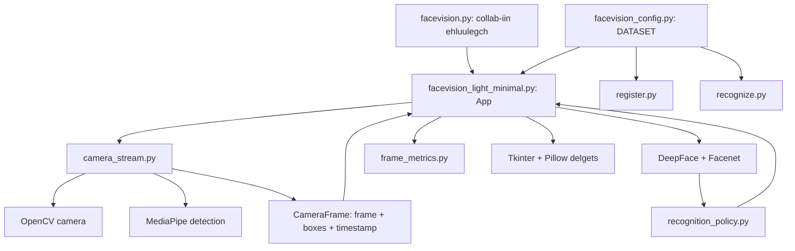

# FACEVISION-iig eh code-toi ni hamt oilgoh delgerengui tailbar

Ene tailbar ni ene workspace dotor odoo baigaa kodiig unshij bichsen. Taamagaar scripts/, tests/-iig tailbarlaagui. App-iin ajilladag kodiig ene tailbariig hiihdee oorchloogui.

Chinii asuusan 3 zuiliig hamt tailbarlana: **ene mor yu gesen ug ve, yagaad heregtei ve, FACEVISION dotor yag haana ashiglagdaj baina ve**.

## Unshih daraalal

1. Python-iin import, class, self, function-iig oilgono.
2. Camera-iin zurag ner boloh hurtelh data-g dagana.
3. Undsen app-iin function buriig zadalna.
4. Recognition, tracking, camera worker-iin dotood logikiig harna.
5. Register, recognize, main-iin tusdaa program-uudiig haritsuulna.
6. Build, tests, benchmark-iig yag eh code deer ni tailbarlana.

## 1. Program, san, model, module gedeg 4 oor zuil

**Program:** chinii ajilluuldag FACEVISION. Tovchluur, camera, hadgalalt, taniltiin durem ni chinii code.

**San / library:** busdiin beldej ogson heregsel. Jishee ni OpenCV camera neeh, NumPy olon toon deer hurdan bodoh heregsel ogno. Chinii program edgeer heregsliig duudaj ashiglana.

**Model:** omno ni surgasan, zurag oruulahad tootsoolson hariu gargadag tohiruulsan toon parametruud. FaceNet bol nuurnii embedding gargah model. MediaPipe-iin FaceDetection ni nuurnii bairlal oloh model ashiglana.

**Module:** Python-oos import hiij boloh negj. Ihend ee neg `.py` file, esvel package dotorh module. Chinii `recognition_policy.py` ch module, busdiin `numpy` ch import hiij boloh module/package.

FACEVISION ni FaceNet-iig shineer surgahgui. Omno surgasan model-d zurgiig oruulj embedding avna, ter embedding-uudiig ooriin duremeer haritsuulna. Hun burtgeh ni model-d training hiihtei adil bish.

## 2. `import`, `from ... import`, `as` gej yu ve?

### 2.1 `import time`

```python
import time
now = time.monotonic()
```

`time` module-iig ene file dotor ashiglah bolomjtoi bolgono. `time.monotonic` gedeg ni time module dotorh function. Tseg ni 'ene zuiliin dotroos ter zuiliig av' gesen utgatai.

`import` ni suulgah command bish. San ehleed orchind baigaa baih ystoi. Baikhgui bol `ModuleNotFoundError` garna. `pip install ...` ni suulgana, `import ...` ni code dotor ashiglana.

### 2.2 `import numpy as np`

```python
import numpy as np
v = np.array([1, 2, 3])
```

`as np` gedeg ni numpy-d ene file dotor bogino ner ogch baina. Hoyor oor san bish. `numpy.array(...)`-iin orond `np.array(...)` gej bichne.

Adilhan:

```python
import tkinter as tk
import mediapipe as mp
```

`tk` ni tkinter, `mp` ni mediapipe-iin bogino ner.

### 2.3 `from pathlib import Path`

```python
from pathlib import Path
home = Path.home()
```

pathlib module dotorh `Path` gedeg class-iig shuud nerledeg bolgoson. Ingej import hiisen bol `Path(...)` gej ashiglana. Harin `import pathlib` gej bichsen bol `pathlib.Path(...)` geh baisan.

### 2.4 Chinii file-oos import hiih

```python
from recognition_policy import match_identity, MultiFaceTracker
```

Python `recognition_policy.py`-g module gej olno. Tendees 2 zuiliig avna:

- `match_identity`: neg vector-iig burtgeltei vector-uudtai haritsuulah function.
- `MultiFaceTracker`: olon nuurnii bairlal, ner, taniltiin tolov udirdah class.

Ene 2-iig pip-eer suulgahgui. Chinii project dotorh code. Harin `recognition_policy.py` ooriin dotroo NumPy ashigladag tul NumPy suusan baih heregtei.

### 2.5 Import hiih ued file-iin code ajillaj bolno

Python module-iig tuhain process dotor ehnii udaa import hiihdee top-level code-iig ni ajilluulna; daraa ni ihendee `sys.modules`-d hadgalsan huvilbariig ashiglana.

`recognition_policy.py`-g import hiih ni class/function-uudiig beldene. Harin `register.py` deer `input(...)`, camera neeh ajil top-level deer baigaa. Tiimees `import register` gehed hunii ner asuuj, camera neeh gej oroldoj bolno.

Ene yalgaanaas bolj test dotor register/recognize-iig shuud import hiihgui, zarim tohirgoogiig `ast`-aar code-iig unshij shalgadag.

## 3. FACEVISION dotor orson san buriin uureg

### 3.1 Python-toi hamt irdeg san-uud

| Import | Yag yund ashiglasan be? | Ene project dotorh jishee |
|---|---|---|
| `os` | Environment variable, huuchin helberiin file/havtasnii uildluud | `os.environ.get('FACEVISION_PROFILE')`, `os.listdir()` |
| `time` | Hugatsaa, ajliin zavsar, FPS | `time.monotonic()`, `time.sleep()` |
| `queue` | Worker-iin hariug UI-d ayulgui damjuulah | `self.q.put(...)`, `get_nowait()` |
| `threading` | Tusdaa ajil ehluuleh, thread-uudiig zohitsuulah | `Thread`, `Event`, `Lock` |
| `pathlib.Path` | File/havtasnii zamiig object helbereer udirdah | `Path.home() / 'Documents'` |
| `tkinter` | Desktop tsonh, text, form | `tk.Tk()`, `tk.Label`, `tk.StringVar` |
| `tkinter.ttk` | Style ashigladag widget | `ttk.Button`, `ttk.Entry`, `ttk.Style` |
| `tkinter.messagebox` | Jijig anhaaruulga/aldaanii tsonh | buruu ner, camera neegeegui uyiin warning |
| `dataclasses.dataclass` | Medeelel aguulah class-iin davtagddag kodiig uusgeh | `CameraFrame` |
| `collections.deque` | Hyazgaartai urttai suuliin hemjiltuudiin tsuvaa | suuliin 60 frame-iin tsag |
| `concurrent.futures.ThreadPoolExecutor` | Daalgavriig worker-t ogch Future hariu avah | tusdaa recognize.py |
| `sys` | Program-iin argument, import haidag zam | benchmark-iin `sys.path`; build launcher-iin `sys.argv` |
| `tempfile` | Tur cache-iin havtas | bagtsalsan app-iin Matplotlib cache |
| `runpy` | Module-iig program shig ajilluulah | build launcher minimal app-iig ehluulne |
| `json` | Butetstei hariug file bolgoj bichih | app-iin `--verify-bundle` tailan |
| `traceback` | Aldaa ali mor-uudiig damjsaniig text bolgoh | bundle shalgaltiin aldaa |
| `unittest` | Avtomat test ajilluulah | tests/ dotorh 2 file |
| `unittest.mock.Mock`, `patch` | Camera/UI/tsag-iig testiin orluulagch bolgoh | camera neehgui GUI logik shalgah |
| `types.SimpleNamespace` | Attribute-tai engiin test object | `result.detections`-iig duuraigah |
| `ast` | Python code-iig ajilluulahgui buttsiig ni unshih | DATASET import-iig shalgah |

`time.monotonic()` ni computer-iin on sar tsagiig bish, hugatsaanii hoorondiin zoruu hemjih tasraltgui tsag. System-iin tsag soligdohod timer-iin tootsoolol savlahgui baihad heregtei. `register.py`, `main.py`-iin zarim timer `time.time()` ashigladag, shine app/worker/tracker ni monotonic ashigladag.

Tkinter ni Python-iin standard module ch OS/Python-iin suulgalt dotor Tk demjleg baih heregtei. Chinii Mac-iin orchind suusan, app build dotor ch bagtsalsan.

### 3.2 Gadnaas suulgadag san-uud

**OpenCV (`import cv2`)**

Camera-aas frame avna, mirror hiine, ongo huvirgana, huree/bichig zurana, file ruu zurag hadgalna. OpenCV ooroo ene project-iin 'Carlo mon uu?' shiidveriig gargahgui.

```python
capture = cv2.VideoCapture(0, cv2.CAP_AVFOUNDATION)
```

- `0`: songoh camera-iin index. Ehnii camera-iig songoh huselt.
- `CAP_AVFOUNDATION`: macOS-iin AVFoundation backend ashiglah huselt.
- Camera neegdsen esehiig zaaval `isOpened()`-oor shalgana.

```python
ok, frame = capture.read()
```

`ok` ni unshilt amjilttai esehiig helne. `frame` ni NumPy array. Frame avch chadaagui bol frame-iig zurag meteer ashiglahgui.

**NumPy (`import numpy as np`)**

Zurag bolon vector-uudiig toon array bolgoj, olon toon deer zereg tootsoolno. `np.array`, `np.stack`, `np.linalg.norm`, `np.sort`, `np.clip`, `np.mean` ene project dotor ashiglagdana.

**MediaPipe (`import mediapipe as mp`)**

Zurgiig oruulahad nuur-iin detection-uud gargana. Detection buriin dotroos relative bounding box avna. Ene ni haana nuur baigaag helne; ner-iig helehgui.

```python
mp.solutions.face_detection.FaceDetection(
    model_selection=0,
    min_detection_confidence=0.6,
)
```

`model_selection=0` ni ene API-iin short-range detector-iig songono. `0.6` ni detection-iin score-d tavih bosgo. Ene score ni Carlo mon baih magadlal bish. Recognition-iin `LIMIT=0.36`-tai oor hemjigdehuun.

**DeepFace (`from deepface import DeepFace`)**

Model songoh, zurgiig model-d taaruulah, embedding gargah zereg ajliig holboj ogdog san. Chinii code `DeepFace.represent(...)` ashiglana. DeepFace-d `verify()` baij bolno ch ene project-iin recognition shiidver `verify()`-g duudahgui, `match_identity()`-g ashigladag.

**FaceNet**

Import hiideg tusdaa `Facenet` module-iin ner bish, `model_name='Facenet'` gej songoson pretrained model. Chinii shalgasan model 128 toon utgatai embedding gargasan. Ter 128 too ni 'hamriin urt', 'nudenii zai' gej hunii garaar nerlesen hemjees bish; surgasan model-iin sursan representation.

**ONNX Runtime (`onnxruntime`)**

Model-iin tootsoolol ajilluulah engine. Odoo build-iin orchin DeepFace-iin ONNX backend ashigladag. `.onnx` file ni model, ONNX Runtime ni ter model-iig ajilluulah engine. UI-iin `embedding()` dotor onnxruntime-g shuud import hiigeegui, DeepFace dotroos ashiglana.

**Pillow (`from PIL import Image, ImageTk`)**

Pillow-g suulgahdaa `Pillow` gej nerledeg ch import ni `PIL`. `Image` ni zurag object uusgeh, hemjee tohiruulah; `ImageTk` ni Tkinter-iin haruulj chadah PhotoImage bolgoh uuregtei.

```python
img = Image.fromarray(cv2.cvtColor(frame, cv2.COLOR_BGR2RGB))
self.photo = ImageTk.PhotoImage(img)
```

OpenCV-iin NumPy frame-iig Tkinter shuud haruulahgui tul ene guur heregtei.

**PyInstaller**

Camera esvel tanih uyd ajilladag san bish. `.app` beldeh build tool. Python interpreter, chinii code, native library, model-iig neg app bagtsad oruulna.

**gdown, Matplotlib, busad dam dependency**

Chinii UI dotor gdown-g shuud duudahgui. DeepFace-iin weight helper import hiihdee gdown ashigladag tul gdown metadata-g build-d bagtsalsan. Matplotlib ni MediaPipe-iin import graph-aar orj irj bolno; chinii app graph/chart zurdag gesen ug bish. Direct import baga baih ni dotood dependency baihgui gesen ug bish.

`customtkinter` odoo ene minimal file dotor baihgui. Ene UI ni Tkinter + ttk. Omno tur hiisen v2-tei anduurch bolohgui.

## 4. Python-iin code unshihad heregtei undes

### Class, object, `self`

```python
class App:
    def __init__(self, root):
        self.root = root
```

`App` ni app object-iig yaj uusgeh zagvar. `App(root)` ni neg bodit object uusgene. `__init__` tuhain object-iin ehnii tohirgoog hiine. `self` ni ter object ooroo.

`self.mode` bol tuhain app-iin mode. Engiin `mode` local huvisagch function duusahad baihgui bolj bolno; `self.mode` object dotor hadgalagdaj busad method-oos ashiglagdana.

### Function ba method

`match_identity(...)` ni tusdaa function. `app.open_camera()` ni App object-iin method. Hoyulaa code-iin ajil hiideg heseg, harin method object-iin tolovtoi holbootoi.

### `None`, `True`, `False`, hooson collection

- `None`: odoohondoo heregtei object/hariu baihgui.
- `False`: bool hudal tolov.
- `[]`: hooson list.
- `{}`: hooson dictionary.

`self.confirmed is None` gedeg ni hun Unknown gej ergelzeegui togtooson gesen ug bish; batalgaajsan ner baihgui gesen ug.

### `return`, `continue`, `break`, `pass`

- `return`: odoo ajillaj bgaa function-oos garna, heregtei bol hariu avch garna.
- `continue`: loop-iin ene davtaltiig algasaad daraagiin davtalt ruu orno.
- `break`: loop-oos garna.
- `pass`: ene hesegt yu ch hiihgui, syntax-iin hooson bair.

`return` ni program-iig bugdiig haah albagui. Harin camera-iin `while True` dotor `break` hiigeed daraa ni resource chuluulj bgaa bol camera-iin loop duusna.

### Callback, `lambda`, `*args`

```python
ttk.Button(..., command=self.open_camera)
```

Function-iig odoo ajilluulahgui; tovch daragdahad duudahaar ogch baina. `command=self.open_camera()` gej bichvel tovch beldeh ued shuud ajilluulah bolno.

```python
command=lambda: self.change_mode('recognize')
```

`lambda` ni argumentgui jijig function. Daragdah ued `change_mode('recognize')`-g duudna.

```python
def background(self, kind, fn, *args):
    result = fn(*args)
```

`*args` ni 0 esvel olon argument-iig tsugluulna. `fn(*args)` ni ter argument-uudiig zadlaad function-d damjuulna. `background('recognize', self.recognize, items)` gedeg ni worker dotor `self.recognize(items)` ajilluulna.

### `if __name__ == '__main__'`

File-iig `python file.py` gej neesen bol `__name__` ni `'__main__'`. Import hiisen bol module-iin ner baina. Ene nuhtsol camera/tsonh-iig zovhon program gej neesen ued ehluulj, import hiihdee ehluulehgui baihad heregtei.

### `try`, `except`, `finally`, `with`

`try` ajil hiine, `except` aldaag bariad hariu uildel hiine, `finally` amjilt esvel aldaa ali ch ued tseverlegee hiine. Camera release hiih ajil end ordog.

`with self._lock:` ni lock avaad, block duusahad avtomataar tavina. `with patch(...):` ni testiin tur soliltiig block duusahad butsaana.

## 5. Negen zurag program dotor yaj oorchlogdoh ve?

Jishee ni camera 640x480 ongot frame ogloo gej uzye.

1. **NumPy frame:** shape ni `(480, 640, 3)`. Ehnii too ondor, daraagiin too orgon, suuliin 3 ni ongonii channel.
2. **BGR -> RGB:** OpenCV-iin channel daraalal BGR, MediaPipe/Pillow-d RGB oruulna.
3. **Bounding box:** `(x1, y1, x2, y2)`, jishee `(100, 80, 240, 250)`.
4. **Crop:** nuurnii hesgiig array-aas tasalna, zovhon ter hesgiig model-d ogno.
5. **Embedding:** Facenet-iin 128 toon vector.
6. **Normalization:** vector-iig uurt ni urtaar huvaaj unit length bolgono.
7. **Comparison:** burtgeltei vector-uudtai cosine distance bodno.
8. **Candidate:** `Carlo` esvel `Unknown`.
9. **Track + confirmation:** ali haragdaj bgaa nuur ve, ner togtvortoi yu gedgiig shalgana.
10. **Display:** huree, ner-tei NumPy frame -> Pillow image -> Tk PhotoImage.

Dataset dotorh JPG-uud ni zurag file. `known` dictionary dotorh embedding-uud ni program ajillaj baih uyiin RAM dotorh medeelel. Odoo embedding-uudiig SQLite database-d bainga hadgalah code baihgui.

```python
known = {
    'Carlo': np.array([...]),  # jishee shape (12, 128)
    'Other': np.array([...]),
}
```

12 zurag burtguulsen bol 12 vector. Shape `(12,128)` ni 12 mor, mor bur 128 too.

## 6. File-uudiin holboo



Chinii ene local workspace-d `facevision.py` baihgui. Collab repo deer suuld nemsen facevision.py ni minimal app-iig ehluuleh jijig wrapper. Local deer `python facevision_light_minimal.py` gej ajilluulna. Hoyor repo-iin ene yalgaag anduurch bolohgui.

## 7. `facevision_config.py`: neg dataset zam

Import ni `from pathlib import Path`.

```python
DATASET = Path.home() / 'Documents' / 'FACEVISION' / 'dataset'
```

`Path.home()` ni ajilluulj bgaa hereglegchiin home havtas. Path object deerh `/` ni toog huvaah bish, zam zalgah operator. Jishee ni `/Users/name/Documents/FACEVISION/dataset` bolno.

File dotor function baihgui. `DATASET` constant-iig busad file import hiine. Tom useg ni 'tohirgoo/constant meteer ashiglana' gesen bichlegiin zanshil; Python ooroo oorchlohgui gej horiglohgui.

Ene file folder-iig import hiihdee uusgehgui. Hadgalah ued `mkdir(...)` hiideg. Zurguud neg gazar baih ni app/CLI-iin burtgel zoruug arilgana; buh app/CLI neg dor ajillaval RAM dotorh known avtomataar zereg shinechlegdene gesen ug bish.

## 8. `facevision_light_minimal.py`: hereglegchiin ajilluulah undsen app

### 8.1 Ene file-iin import buriin uureg

- `os`: FACEVISION_PROFILE=1 tohirgoog unshina.
- `time`: timer, frame-iin hugatsaa, tanih ajliin zavsar.
- `queue`: background hariug main thread-d damjuulna.
- `threading`: load/recognize daalgavriin worker.
- `Path`: import baigaa ch ene huvilbar dotor ashiglagdahgui; DATASET-iig config-oos avdag bolsonii daraah uldegdel. Ene ni ooroo program-iig evdehgui.
- `tk`, `ttk`, `messagebox`: UI.
- `cv2`: crop-iin chanar, overlay, file hadgalalt, ongo huvirgalt.
- `np`: embedding-iin array/normalization, known matrix.
- `Image`, `ImageTk`: camera-iin frame-iig Tk-d haruulah.
- `match_identity`, `MultiFaceTracker`: chinii haritsuulalt/tracking code.
- `DATASET`: niitleg zam.
- `CameraStream`: belen camera frame avah worker.
- `FrameMetrics`: FPS bolon hugatsaag hemjih.

### 8.2 STAGES, LIMIT

`STAGES` ni 4 bairlal: urdaas shilgui, urdaas shiltei, baruun, zuun. Program tolgoi baruun ergesen esehiig model-oor shalgahgui; ene ni hereglegchid ogoh zaavar. Shilgui/shiltei gesniig ch detector batalgaajuulahgui.

`LIMIT=0.36` ni cosine distance-iin bosgo. Baga distance iluu oir gesen utgatai. Ene ni 36% bish; 64%-iin itgeltei tanina gesen ug bas bish.

### 8.3 `App.__init__(self, root)`

**Orolt:** Tk-iin undsen tsonh `root`. **Butsaah:** shuud ashiglah hariu baihgui (`None`); object-iin tolov/UI-g beldene.

Gol huvisagchuud:

| Huvisagch | Uureg |
|---|---|
| `root` | undsen tsonh |
| `stream` | camera/detection worker object; ehleed None |
| `update_job` | Tk after callback-iin ID; davhar loop uusgehgui |
| `last_sequence` | suuld haruulsan frame-iin dugaar |
| `frame_time` | tuhain frame camera-aas avagdsan tsag |
| `metrics` | FPS/timing hemjilt |
| `profile` | environment variable 1 bol Terminal-d hemjilt hevleh |
| `mode` | detect / recognize / register |
| `running` | camera UI loop ajillaj bgaa esehiig helne |
| `busy` | load/recognize ajil yavj bgaa esehiig helne; camera worker-iin tolov bish |
| `q` | worker-iin hariunii queue |
| `known` | hunii ner -> embedding matrix |
| `tracker` | haragdaj bgaa humuusiin track/ner udirdana |
| `session` | huuchin background hariug shine gorimd ashiglahgui baih generation dugaar |
| `name`, `status`, `fps_text` | UI-tai holbootoi StringVar-uud |
| `stage`, `count`, `total` | burtgeliin bairlal, bairlaliin zurgiin too, niit too |
| `capture_time`, `next_photo` | 3 second-iin beltgel, daraagiin zurag avah tsag |
| `person` | burtguulj bgaa hunii ner |
| `photo` | delgetsend haruulsan PhotoImage-iig RAM-d hadgalah reference |
| `deepface` | model wrapper-iig heregtei bolson ued ni achaalah hadgalalt |

`results`, `boxes`, `result_time`, `last_check`, `last_metrics_update`, `last_profile_report` zereg tuslah tolovuud bas baina. `results`/`result_time`-iin zarim ni huuchin code-iin uldegdel; odoo neriiin gol eh survalj tracker.

`self.photo` yagaad heregtei ve? Tk image-iin Python reference baihgui bol garbage collector avch, delgets deer image alga boloh bolomjtoi. Tuhain image-iig object dotor hadgaldag.

`root.after(60,self.poll)` ni '60ms orchmiin daraa poll-iig duud' gej GUI-d huselt ogno. 60ms tutam yag realtime batalgaatai duudna gesen ug bish.

### 8.4 `_build_light_ui(self)`

**Orolt:** self. **Butsaah:** None. **Uildel:** widget-uud uusgej, self.screen zereg reference hadgalna.

- Root-iin geometry 1000x760 bolno; __init__-iin 850x700-iig ene shine tohirgoo darna.
- `ttk.Style()` tovchluuruudiin font, background, padding, hover/active ongo tohiruulna.
- `Frame` ni widget-uudiin sav.
- `Label` ni text esvel image haruulna.
- `Entry` ni ner oruulah field.
- `Button` ni callback duudna.
- `StringVar` textvariable-aar Label/Entry-tei holbogdono.
- `.pack(...)` ni bairshuulah geometry manager; `side`, `fill`, `expand`, `padx`, `pady` ni bairshil/zaig udirdana.
- `sidebar.pack_propagate(False)` ni dotood widget-iin hemjeenees bolj sidebar-iin hemjee avtomataar savlah-g zogsoono.

`style.map(...active...)` ni mouse/active toloviin ongo, model-iin confidence bish.

### 8.5 `toggle_register_panel(self)`

**Butsaah:** None. `winfo_manager()` hooson bish bol panel bairshsan baina gej uzeed `pack_forget()` hiine. Hooson bol `pack(...)` hiij haruulna. Widget-iig ustgahgui; ner oruulsan data ni hadgalagdaj bolno.

### 8.6 `open_camera(self)`

**Butsaah:** None. Camera alhemiig asynchronous ehluulne.

1. Running bol davhar neehgui.
2. Omnoh stream haagdaj duusaagui bol tur huleeh status ogno.
3. Shine `CameraStream()` uusgene.
4. Sequence, metrics-iig shinechilne.
5. `running=True`, status neegej bgaa bolno.
6. `stream.start()` worker ehluulne.
7. `schedule_update(10)` UI polling ehluulne.

Ene function dotroo `cap.read()` hiihgui. Camera neeh ajil worker deer yavna. `running=True` bolson ni camera amjilttai neegdsen batalgaa bish; worker aldaag `update()` unshij haruulna.

### 8.7 `schedule_update(self, delay_ms)`

**Orolt:** huleeh millisecond. **Butsaah:** None. Running ba update_job baihgui uyd l `root.after(...)` uusgej ID-g hadgalna. Uuniig davhar duudsan ch 2 zereg update loop uusgehgui baih zorilgotoi.

### 8.8 `close_camera(self)`

- Session-iig nemegduulj huuchin background hariug huchingui bolgono.
- Tracker-iig tseverlene.
- Running=False.
- Pending `after` callback baival `after_cancel` hiine.
- Worker-t `stop()` huselt ogno.
- UI image/reference-iig tseverlej closed text haruulna.

Camera-g main thread deer shuud release hiihgui. Worker ooriin `finally` dotor camera/detector-oo chuluulna. Stop ni husej bgaa tolov bolohoos OS-iin read-iig hucheer tasaldag command bish.

### 8.9 `change_mode(self, mode)`

**Orolt:** ene code-oos `'detect'` esvel `'recognize'`. **Butsaah:** None.

Busy bol gorim solihgui, status hulee gej haruulna. Gorim solihod session nemj, tracker/capture timer-iig tseverlene. Recognize bol `background('load',self.load_people)`-g ehluulne. Detect bol nuur ilruuleh status tavina.

Gorim solih ni camera shineer neehtei adil bish. Camera-iig tusad ni neesen baih ystoi.

### 8.10 `embedding(self, image)`

**Orolt:** zurgiin zam string esvel crop NumPy array. **Butsaah:** normalize hiisen NumPy vector, esvel norm 0 bol None.

`self.deepface is None` uyd l import hiine. Ene ni program-iin UI ehleh deer model-iin san-g zaaval shuud achaalahgui baih lazy loading.

```python
result = self.deepface.represent(
    img_path=image,
    model_name='Facenet',
    detector_backend='skip',
    enforce_detection=False,
    align=False,
)
```

- `img_path` gesen nertei ch ene API array avch chadna.
- `skip`: DeepFace-iin dotood detector-iig dahij ajilluulahgui; nuur crop-iig omno MediaPipe-aar beldsen gej uzne.
- `enforce_detection=False`: DeepFace ooroo nuur oloogui gej aldaa zaaval gargah shaardlagagui. Ene ni crop zov nuur mun gedgiig batalahgui.
- `align=False`: nudnii bairlalaas hamaaruulj alignment hiihgui.

`result[0]['embedding']` ni ehnii representation-iin vector. `np.float32` ni toon turul. `norm=np.linalg.norm(v)`, `v/norm` ni unit vector. `norm==0` bol huvaaj NaN uusgehgui, None butsaana.

### 8.11 `load_people(self)`

**Orolt:** self, DATASET. **Butsaah:** `dict[str, ndarray]` utgatai known dictionary.

Folder buriin ner ni hunii ner. `.jpg`, `.jpeg`, `.png` file-uudiig embedding bolgono. Olon vector-iig `np.stack(vectors)`-aar matrix bolgono. Zurag unshilt/model-iin aldaag print hiigeed ter zurgiig algasna. Zuraggui folder-iig known-d nemehgui.

Ene function RAM-iin shine dictionary gargadag, JPG-uudiig oorchlohgui. DATASET baihgui bol hooson dictionary butsaana. Hunii too ni zurgiin too bish, known dictionary-iin key-iin too.

### 8.12 `recognize(self, items)`

**Orolt:** `[(track_id, crop), ...]`. Code dotor loop-iin ehnii huvisagchiig `box` gej nerlesen ch odoo end track ID irdeg. Ner ni huuchirsan, bodit utga ni rectangle bish.

**Butsaah:** `[(track_id, 'Carlo'), (other_id, 'Unknown'), ...]`.

1. Default ner Unknown.
2. Crop-iin hoyor taliin baga ni 90px-ees baga bol tanihgui.
3. Grayscale bolgood Laplacian variance >=35 esehiig shalgana.
4. Chanar hangaval embedding gargana.
5. `match_identity`-d known-toi ni ogno.
6. Aldaa garval print hiigeed Unknown uldene.

Unknown ni zaaval burtgelgui hun gesen ug bish. Jijig, budeg crop, model-iin aldaa, bosgo davsan, ner-uud oir onootoi zereg shaltgaantai baij bolno.

### 8.13 `background(self, kind, fn, *args)`

**Orolt:** ajliin ner (`load`/`recognize`), ajilluulah function, argument-uud. **Butsaah:** ehluulj chadsan bol True, busy bol False.

Shine worker closure ooriin session/captured_at-iig sanana. Recognition-d UI ajil ehluulsen tsag bish, frame camera-aas avagdsan `frame_time` ashiglana.

Worker UI-iin widget-uudiig shuud oorchlohgui. Hariug queue-d hiine:

```python
(kind, result, error, session, captured_at, elapsed_ms)
```

Amjilt bol error=None. Aldaa bol result=None, error=str(e). `daemon=True` worker ni process-iig gantsaaraa amid bailgahgui; ajil duusgah batalgaa bish.

### 8.14 `poll(self)`

**Butsaah:** None. UI thread deer worker-iin hariug huleelguigeer unshina.

`get_nowait()` queue hooson bol queue.Empty shidne. Ene ni program-iin evdrel bish, ene davtaltdah ajil duussan gesen heviin tolov; except dotor pass hiine.

- Busy=False bolgono.
- Session huuchin bol hariug hayna.
- Metrics-d elapsed_ms hadgalna.
- Error bol status deer haruulna.
- Load bol self.known-iig shine dictionary-goor solino.
- Recognize bol tracker.apply(...) duudna; shine batalgaajsan ner baival status haruulna.

Daraagiin poll-iig 60ms-iin daraa zahialna. Poll ni camera frame-iin latest-slot bish; edgeer 2 tusdaa damjuulalt.

### 8.15 `register(self)`

**Orolt:** Entry-iin ner. **Butsaah:** None.

Neriig strip hiij tseverlene. Hooson, 40-ees urt, useg/too/_/--ees oor temdegttei neriig huleej avahgui. `isalnum()` ni Unicode useg/too-g demjine, zovhon English useg bish.

Camera running baih ystoi. Session/track tseverlene, person hadgalna, stage/count/total-iig 0 bolgono, mode register bolno. Ene function ooroo zurag shuud avahgui.

### 8.16 `take_photos(self)`

Register mode ba capture ehleegui uyd `capture_time=monotonic()+3`. `next_photo` ch ter tsag bolno. Daraagiin 3 second tur beltgel haruulaad update() zurag avna. Ene 3 second ni recognition-iin 0.3 second bish.

### 8.17 `skip(self)`

Zovhon register mode-d `next_stage()` duudna. Zurag avahgui ue shat algasaj bolno. Program 'zaaval 12 zurag avsan' gej batalgaajuulahgui.

### 8.18 `next_stage(self)`

Stage 1-eer nemne, bairlaliin count=0, capture_time=None. 4 bairlal duussan bol mode detect, niit hadgalsan too haruulna. Ugui bol daraagiin zaavar tavina.

Zurgiin too 3 hurehed update()-aas duudagdana; skip()-ees ch duudagdana.

### 8.19 `save_photo(self, crop)`

**Orolt:** nuurnii BGR NumPy crop. **Butsaah:** `cv2.imwrite`-iin bool amjilt.

DATASET/person havtasiig uusgene. `person_new_1.jpg`, `_2.jpg` geh met ner-iig shalgaj, baigaa file-iig darj bichihgui daraagiin sul dugaar songono. `str(path)` ni OpenCV-d string zam bolgoj ogno.

### 8.20 `update(self)`: camera-iin delgets shinechleh neg alham

Ene function ni `while True`-g UI thread deer ashiglahgui. Tk-iin event loop daraagiin callback-iig duudadag.

1. Update_job=None gej odoo callback ajillaj ehelsniig temdeglene.
2. Running bish bol return.
3. Stream.error baival camera haaj status tavina.
4. `stream.latest(last_sequence)`-ees SHINE frame husne.
5. Shine frame baihgui bol 8ms-iin daraa dahin shalgahaar schedule hiigeed return; image davtaj uusgehgui.
6. Packet-iin sequence, timestamp, timings hadgalna.
7. Worker-iin image-iig `.copy()` hiine. Overlay-g worker-iin shared frame deer zurahgui.
8. Tracker.update(boxes,now) haragdaj bgaa PersonTrack-uud butsaana.
9. Recognize mode ba busy bish ba 0.15 second ongorson bol shalgah heregtei track buriin crop beldene.
10. Background recognition ehluulne.
11. Register mode bol beltgeliin timer, zurag avah nuhtsol, hadgalaltiig ajilluulna.
12. Track-uudiin display_box deer label/huree zurana.
13. Frame-iig RGB/Pillow/Tk PhotoImage bolgoj haruulna.
14. Metrics/FPS shinechilne.
15. 30 FPS-iin frame budget-iin uldsen hugatsaag huleej daraagiin update-iig schedule hiine.

Crop:

```python
crop = frame[top:bottom, left:right].copy()
```

Array-iin index ni ehleed y, daraa ni x. Python slice-iin suuliin hyazgaar bagtahgui. `pad=face_width*0.15` ni nuurnii hureend orchnii nemelt zai ogno. Ene 0.15 ni 0.15 second-iin polling-toi holboogui.

Burtgeliin crop deer 90px / sharpness35 shalgana. Amjilttai zurag avbal daraagiin zurag +0.8 second, chanar muu/olon nuur bol +0.3 second-iin daraa dahin oroldono. 4 bairlal x 3 zurag = heviin duusgalt deer 12; algasval baga baij bolno.

`img.thumbnail(...)` ni hemjeeg savand bagtaaj jijigruulna, aspect ratio hadgalna, jijig zurgiig zaaval tomruulahgui. Kameraas model-d oroh crop-iin resolution-iig ene preview resize solihgui.

`max(1, int(1000/30 - elapsed_ms))` ni 33.3ms frame budget-oos ajild zartsuulsan hugatsaag hasna. Zorilt ni 30 displayed FPS; bodit hurd camera/model/OS-oos hamaarna.

### 8.21 `exit(self)`

`close_camera()` hiigeed `root.destroy()` duudna. Camera haah ni app-iig zaaval haahgui; exit ni undsen tsonhiig ustgana.

### 8.22 File-iin suuliin 4 mor

```python
root = tk.Tk()
App(root)
root.mainloop()
```

Tk root uusgene, App ni widget/tolovuudiig beldene, mainloop ni event-uudiig huleej callbacks duudna. mainloop ni tsonhnii tolov/bodlogiig ooroo medehgui; chinii ogson command/after-uudiig ajilluulna.

## 9. `camera_stream.py`: camera/detection-iin worker

### 9.1 Imports

`dataclass` ni packet class-iig tovch uusgene. `threading` ni Thread/Event/Lock. `time` ni monotonic timestamp/timing. `cv2` ni camera, mirror, ongo huvirgalt. MediaPipe-g _open_detector() dotor heregtei bolson ued import hiine.

### 9.2 `CameraFrame`

```python
@dataclass(frozen=True)
class CameraFrame:
    sequence: int
    captured_at: float
    image: object
    boxes: tuple
    read_ms: float
    detect_ms: float
```

`CameraFrame(...)`-iig uusgeh constructor, representation zereg davtagdah kodiig dataclass beldene. `: int` zereg ni type hint; Python zaaval int baina gej runtime deer avtomataar shalgahgui.

- sequence: 1,2,3... frame-iin dugaar.
- captured_at: capture.read() duussan monotonic tsag; sensor exposure-iin yag tsag bish.
- image: NumPy frame.
- boxes: pixel rectangle-uudiin tuple.
- read_ms: read() huleeltiin ms.
- detect_ms: mirror/RGB/detection/box gargaltiin hugatsaa.

`frozen=True` ni packet.sequence=2 gej field solihiig horiglono. Gehdee image array dotorh pixel-iig ooroo immutable bolgohgui. Tiimees UI packet.image.copy() ashigladag.

### 9.3 `CameraStream.__init__(capture_factory=None, detector_factory=None)`

**Orolt:** camera object, detector object uusgeh function-uud; ogoogui bol default-uud. **Butsaah:** None.

Factory gedeg ni object ooroo bish, object uusgeh function. Test dotor bodit camera-iin orond `lambda: fake_capture` ogch bolno.

- `_stop=Event()`: ajliig zogsooh huseltiin dohio.
- `_lock=Lock()`: 2 thread zereg `_latest`/`_error` unshij/bichih ajliig zohitsuulna.
- `_thread`: worker thread; ehleed None.
- `_latest`: suuliin belen CameraFrame.
- `_error`: aldaanii text.

Neg `_`-eer ehlelsen ner ni dotood heregleend zoriulsan gesen convention. Python garaar handahiig hatuu horiglohgui; test `_latest`-d handaj bgaa ni dotood logikiig shalgah zorilgotoi.

### 9.4 `_open_capture()`

`@staticmethod`: self avah shaardlagagui, class dotorh tuslah function. **Butsaah:** OpenCV VideoCapture.

Camera0/AVFoundation neene, width640/height480 husne. set() ni camera zaaval ter hemjeeg demjine gesen batalgaa bish; bodit frame.shape-g code ashiglana. Neegdsen esehiig _run() shalgana.

### 9.5 `_open_detector()`

**Butsaah:** MediaPipe FaceDetection object, model0/confidence0.6. Model-iig frame bur deer shineer uusgehgui, worker ehleh ued neg udaa uusgej process()-g olon udaa duudna.

### 9.6 `alive` property

`@property` uchraas `stream.alive`, `stream.alive()` bish. Thread object baigaa ba `is_alive()` True uyd True. Camera tanilt zov esehiig helehgui; worker thread amid esehiig helne.

### 9.7 `error` property

Lock avaad `_error` butsaana. Heviin ued None. UI ene utgaar camera/detector-iin aldaag medne.

### 9.8 `start()`

Neg instance-iig neg l udaa start hiine. Omno `_thread` uussen bol RuntimeError. Camera-g dahin neeh bol shine CameraStream uusgeh ystoi.

`Thread(target=self._run,daemon=True,name='facevision-camera')` uusgeed start(). target ni worker-iin hiih ajil. start() duudah ni _run()-g UI thread deer shuud duudahtai adil bish.

### 9.9 `stop()`

`self._stop.set()` huselt. Main thread camera.read() duusahiig join hiij huleehgui. Worker read/detection-oos butsaad event-iig shalgaj loop-oos garna.

### 9.10 `latest(after_sequence)`

**Orolt:** UI-iin suuld haruulsan frame dugaar. **Butsaah:** tuunees shine CameraFrame, esvel None.

```python
stream.latest(10)
```

Suuliin belen frame #15 bol #15 butsaana; #11-14-iig tsuvruulahgui. Suuliin frame bas #10 bol None. Camera image-iin queue baihgui, neg slot baina. Queue bol zuvhun load/recognize task-iin hariund ashiglagdana.

### 9.11 `_run()`

Camera/detector uusgej loop ajilluulna. `_stop` set boltol:

1. Started tsag.
2. `capture.read()` -> ok,frame.
3. Captured_at tsag.
4. Stop shalgana.
5. Ok bish bol aldaa.
6. `cv2.flip(frame,1)` mirror.
7. `cv2.cvtColor(...BGR2RGB)`.
8. `detector.process(...)`.
9. Relative box-iig pixel box bolgono.
10. Sequence nemj CameraFrame uusgene.
11. Lock dotor `_latest`-iig shine packet-aar solino.

Relative box-iin jishee: xmin0.25, ymin0.20, width0.20, height0.30, frame640x480 bol x1=160, y1=96, x2=288, y2=240. Relative width ni baruun hyazgaar bish; x2=(xmin+width)*frame_width.

`max(0,...)`, `min(frame_width,...)` ni zurgiin hilee davahgui baih clamp. x2<=x1 esvel y2<=y1 bol huchingui box-g algasna.

Except bol `_error`-d str(error). Finally bol camera.release(), detector.close(). Ene tseverlegee ehnii aldaa, read aldaa, detector aldaa, engiin stop ali ch zamd heregtei.

## 10. `recognition_policy.py`: ner songoh ba nuur dagah durem

Ene file **camera neehgui, model ajilluulahgui**. Belen vector ba bounding box deer tootsoolol hiine. Imports: zuvhun NumPy.

### 10.1 `match_identity(vector, known_faces, threshold=0.36, margin=0.08)`

**Orolt:** normalize hiisen shine vector, ner->normalize hiisen vector-uudiin matrix, 2 bosgo. **Butsaah:** hunii ner esvel `'Unknown'` string.

```python
distances = 1 - vectors @ vector
```

`@` ni matrix/vector urjilt; Python-iin engiin `*` bish. Vector-uud unit length bol dot product ni cosine similarity. `1 - similarity` ni cosine distance.

Jijig oilgoh jishee:

```python
v = np.array([1.0, 0.0])
u = np.array([1.0, 0.0])
# v @ u = 1; distance = 0: neg chiglel
```

`[0,1]` bol dot0, distance1. `[-1,0]` bol dot-1, distance2. Bodit embedding128 hemjeestei, ene jishee2 hemjeest.

`np.clip(...,0,2)` floating-point-iin jijig aldaanaas utga hyazgaar davah-g clamp hiine. `np.sort`-oor oir vector-uud ehend orno. `distances[:3]` ni hamgiin oir 3 hurtel zurag. 1 zuragtai bol 1-iig, 2 bol2-iig ashiglana; hamgiin bagadaa3 burtgeliin zurag zaaval baih nuhtsol odoo baihgui.

Score ni ene dundaj. Jishee:

- Carlo: distances0.12,0.18,0.21 -> score0.17.
- Other:0.40,0.43,0.46 -> score0.43.
- 0.17 <0.36, ner-uudiin zoruu0.26 >=0.08 -> Carlo.

Harin Carlo0.20, Other0.24 bol ali ch bosgo davaagui ch zoruu0.04<0.08 tul Unknown. '2 ner hoyulaa tostei onootoi baina, negiig ni hucheer songohgui' gesen durem.

Best score yag0.36 bol Unknown (`>=`). Margin yag0.08 bol ene nuhtsoloor horiglohgui (`<`). Ner ni scoretoi tuple-aar sort hiigdeh tul ijil onoond neriiin alphabetical daraalal orj bolno; gehdee ijil score-giin margin0 tul Unknown bolno.

Burtgeltei ner gants bol runner-up baihgui, margin shalgalt hiigdehgui. Ene ni gants hun burtgeltei sistem deer tostei tanihgui huniig yalgahad margin tuslahgui gesen utgatai.

Function normalized/finite128 vector irne gej uzdeg. Buruu shape, NaN zereg orolt-iig ene function ooroo buheld ni validate hiihgui. App-iin embedding pipeline ter shape-iig beldene.

### 10.2 `Confirmation.__init__(duration=0.3,max_gap=2.5,min_samples=2)`

Neg track-iin neriig shuud ner tavihgui bogino hugatsaand davtaj batalgaajuulah object. Duration ni minimum hugatsaa, min_samples ni minimum shine hariunii too, max_gap ni hariunuudiin hoorond zovshooroh ih zavsar.

### 10.3 `Confirmation.reset()`

name/started/last_seen=None, samples=0. Butsaah None. Ene reset ni buh hunii track-iig ustgahgui, ene confirmation-iin tolov l tseverlene.

### 10.4 `Confirmation.observe(name,captured_at)`

**Butsaah:** batalgaajsan ner esvel None.

- Tsag huuchin/ijil bol shine sample gej toolohgui.
- Unknown/Searching/None bol candidate confirmation reset.
- Ner soligdson esvel zavsar2.5s-ees urt bol shine daraalal ehluulne.
- Last_seen shinechilj sample nemne.
- Hugatsaa>=0.3 ba samples>=2 bol ner butsaana.

Jishee 0.00 Carlo,0.15 Carlo bol odoohondoo None;0.30 Carlo bol Carlo. Harin ehnii2 hariu0.00 ba0.40 bol2 sample ba0.4s tul batalgaajij bolno. Model0.3 second dotor zaaval hariu ogno gesen tohirgoo bish.

### 10.5 `boxes_match(a,b)`

**Orolt:** hoyor `(x1,y1,x2,y2)` box. **Butsaah:** bool.

Ogtloltsliin talbai / hoyoriin niilber talbai (IoU) >=0.3 bol True. Union=areaA+areaB-intersection. Union0 bol False. Ene ni zovhon bairlal/hemjeenii davhtsal, identity tanilt bish.

### 10.6 `PersonTrack.__init__(identity,box)`

Neg hun gej tur holboson rectangle-iin tolov:

- id: camera session-iin track dugaar; ner bish, database-iin hunii dugaar bish.
- box: suuliin raw detection rectangle.
- display_box: zurahad zoolruulsan rectangle.
- confirmation: anhnii neriin davtan shalgalt.
- name: suuliin candidate/Unknown/Searching.
- confirmed: batalgaajsan ner esvel None.
- result_time: suuliin zovshoorogdson taniltiin frame-iin tsag.
- mismatches: batalgaajsan nertei daraalan taarahgui hariunii too.
- visible: odoo frame deer detection-tai esehiig helne.
- last_seen: suuld rectangle haragdsan monotonic tsag.

### 10.7 `PersonTrack.clear()`

Ner/confirmation/result_time/mismatches tseverlene. Track-iin ID, box, visible, last_seen-g ustgahgui. Tuhain bairlaliin huniig shineer tanij boloh tolov bolgono.

### 10.8 `PersonTrack.needs_recognition(now)`

**Butsaah:** bool. Visible bish bol False. Tanigdaagui bol True. Tanigdsan bol result_time baihgui esvel1.5s ongorson ued True.

1.5s ni recheck ajil husen ehluuleh minimum zavsar. Busy/model-iin hurdaas hamaaran hariu iluu udaan irj bolno. Tuhain track shalgah heregtei gej uzsen ch app-iin 0.15s/busy bosgo davj baij task ehluulne.

### 10.9 `PersonTrack.label()`

**Butsaah:** `(text,BGR_color)`.

- confirmed -> ner, `(0,255,0)` nogoon.
- Unknown -> Unknown, `(0,0,255)` ulaan.
- busad -> Searching..., `(0,200,255)` shar/orange.

Candidate ner tur oldson ch ehnii confirmation duusaagui bol candidate0% gej haruulahgui.

### 10.10 `MultiFaceTracker.__init__(missing_grace=0.3)`

Tracks dictionary, next_id0, missing_grace0.3. `tracks[id]` -> PersonTrack. ID-nuud shine track uusgeh bur nemegdene.

### 10.11 `MultiFaceTracker.reset()`

Tracks-iig hoosolno. next_id-g0 bolgohgui. Ene ni huuchin worker-iin ID shine hunii ID-tai sanamsargui ijil boloh-g bagasgadag.

### 10.12 `MultiFaceTracker.update(boxes,now)`

**Orolt:** odoo frame-iin detection rectangle-uud, tsag. **Butsaah:** zovhon ODOO HARAGDAJ bgaa PersonTrack-uudiin list. Dotroo bogino alga bolson track-iig ch tur hadgalj bolno.

1. Omno hidden baisan, grace hugatsaa duussan track-uudiig hayna.
2. Shine box bur ali huuchin track-tai IoU-aar taarahiig candidates-d hiine.
3. Huuchin track heden shine box-d taarj bgaag usage-d toolno.
4. Yag neg candidate, ter candidate-g yag neg box ashiglasan bol track-iig urgeljluulne.
5. Ugui bol shine track uusgene. Ambiguous bol ner hucheer holbohgui.
6. Display_box=0.6*old+0.4*new gej zoolruulne.
7. Huuchirsan, batalgaajaagui result-iig clear hiine.
8. Odoo haragdah track-iin last_seen/visible shinechilne.
9. Odoo oloogui ch grace dotor baigaa, ambiguous davhtsaltad oroltsoogui track-iig hidden-aar hadgalna.
10. Ordered visible list butsaana.

Jishee Carlo-iin hajuud Other shineer orj irhed Carlo-iin candidate holboo neg-negeer heveeree bol Carlo track hadgalagdana. Hoyor nuur davhtsaj ali ni ali track ve gej yalgahad ergelzeetei bol shineer tanina.

Grace ni suuliin haragdsan detection-ii tsagaas tootsoologdono; camera buhlee gatsaj shine packet ogohgui baih buriig zaaval neg-negen missed frame gej toolohgui. Ene code ni camera motion/optical-flow esvel biometrikiin re-ID model bish, rectangle-iin davhtsal deer tulguurlasan engiin association.

### 10.13 `MultiFaceTracker.apply(answers,captured_at,now)`

**Orolt:** `[(id,name),...]`, eh frame-iin tsag, odoo tsag. **Butsaah:** ene batch deer SHINEER batalgaajsan ner-uudiin list; buh visible humuusiin list bish.

`owners` ni batalgaajsan ner->track ID. Bogino grace-d hadgalagdaj bgaa track neree tur ezemshij bolno. `counts` ni ene batch dotor neg candidate ner hed garsnyg toolno.

Track baihgui, hidden, frame2.5s-ees huuchin bol hariug ashiglahgui. Result_time-aas huuchin/ijil tsagtai hariug ashiglahgui.

**Omno batalgaajsan bol:**

- Ijil ner -> mismatches0.
- Oor ner/Unknown -> mismatches+1.
- Mismatches3 hurehed owners-oos hasaj clear, Unknown bolgono.
- Oor neriig shuud tavihgui; daraagiin shine confirmation heregtei.

**Batalgaajaagui bol:**

- Candidate ner oor track deer confirmed bol Unknown.
- Hoyor track zereg ijil candidate ner avsan, hen ni ch owner bish bol hoyulang Unknown. Ehleed heniig ni songoh batalgaa baihgui gej uzne.
- Otherwise observe()-g duudaj minimum2 sample/0.3s shalgana.
- Shine confirmed bol owners shinechilj return list-d ner nemne.

'Neg l Carlo' ni display consistency durem; yag zov huniig Carlo gej songoson batalgaa bish. Ehleed buruu hun confirmed bol jinhene Carlo tur Unknown bolj bolno; davtan shalgalt buruu owner-iig tsutslah bolomj ogno.

## 11. `frame_metrics.py`: FPS ba timing

Imports ni `from collections import deque`.

### 11.1 `FrameMetrics.__init__()`

Presented ni `deque(maxlen=60)`, timings ni dict. 61 deh tsag nemegdhed hamgiin huuchin tsag avtomataar garna. RAM hyazgaargui osgohgui.

### 11.2 `record(name,milliseconds)`

Tuhain ner-iin timing tsuvaand shine hemjilt nemne. `setdefault` key baihgui bol deque uusgej, baival teriig avna. Hariu None.

### 11.3 `present(now)`

Delgetsend SHINE frame haruulsan tsagiig presented-d nemne. Detection process hiisniig bish, app-iin UI image shinechlegdsen tsagiig toolno.

### 11.4 `fps` property

```python
(len(presented)-1)/(last_time-first_time)
```

Yagaad -1 ve? 3 tsagiin tseg ni2 hoorondiin interval-tai. 0.00,0.0333,0.0667 bol2/0.0667=30FPS. Tsag2-oos baga esvel elapsed<=0 bol0.

FPS ni model-iin nariivchlal bish. FPS30 ni second tutam30 displayed frame; DeepFace30 udaa second tutam tanina gesen ug bish.

### 11.5 `report()`

**Butsaah:** `display_fps=... camera_read=...ms detect=...ms ...` string. Timing bur suuliin60 hurtelh sample-iin arifmetik dundaj. Print hiih ni app-iin profile block-iin uureg.

Camera_read ni hardware frame-iig huleesen heviin hugatsaag ch bagtaana. Detect ni mirror/RGB bolon MediaPipe box gargaltiig bagtaana. UI_render ni callback ajliin hugatsaa; delgetsiin physical refresh-iig yag hemjsen bish. Recognize ni neg batch, heden nuur bagtah bolomjtoi.

## 12. `register.py`: Terminal-iin tusdaa burtgel

Imports: cv2 camera/quality/save, mp detector, os path/folder, time timer, DATASET shared config.

Ene ni minimal app-iin register() method-iig duudahgui, ooriin camera loop-toi tusdaa program. Hoyor program neg camera-g zereg neeh gej oroldohgui baih ni zuv.

### 12.1 Top-level ner, folder, detector

`input(...)`-aar ner avna, strip hiine. Hooson, '.'/'..', slash/backslash-tai neriig horiglono. GUI-iin ner shalgaltaas oor: CLI dotor length40/isalnum nuhtsol baihgui.

Folder ni `str(DATASET/name)`. `os.makedirs(...exist_ok=True)` baigaa folder deer shineer aldaa uusgehgui. MediaPipe model0/confidence0.6. Stages4, photos_per_stage3.

### 12.2 `get_image_path()`

**Orolt:** parameter baihgui; global name/folder ashiglana. **Butsaah:** baigaa file-iig darj bichihgui shine `.jpg` string zam. Number1-ees ehlej filename baih hurtel nemne.

### 12.3 `check_quality(image)`

**Butsaah:** `(True/False,message)` tuple.

- image.size0 -> False, Invalid image.
- height esvel width90-ees baga -> False, Move closer.
- Gray Laplacian variance35-aas baga -> False, blurry.
- busad -> True, Good quality.

Laplacian variance ni edge/ondor davtamjiin medeeleliin engiin sharpness hemjilt. Gerel, noise, background-oos nuluulul avna; nuur zov burtguulsen gesen batalgaa bish.

### 12.4 `while stage_index < len(stages)`

1. Camera frame avna; aldaatai bol break.
2. Mirror, RGB, detection.
3. Pixel boxes.
4. `clean_frame=frame.copy()`.
5. Display deer zaavar, stage, too, message zurana.
6. Yag1 nuur bol clean_frame-aas padding-tai crop avch quality shalgana.
7. Capture ehlesen bol countdown esvel next_capture_time shalgana.
8. Yag1 nuur ba chanar hangaval imwrite hiine.
9. Amjilttai bol stage_saved, saved_total nemne; next+.8s.
10.3 zurag duusval stage nemne, next stage-d Space dahin darna.
11. Q break; N capture yavahgui ued stage algasna; Space belen ued3s beltgel ehluulne.

Clean_frame-iin ach holbogdol: 'Press SPACE', stage number zereg text nuurnii crop deer hadgalagdahgui. Zurgiin hadgalalt display overlay-oos tusdaa.

`time.time()` ene standalone file-d ashiglagdana, GUI-iin monotonic-toi yalgaatai. Ene tailbart code-iig oorchloogui.

File suuld cap.release(), detector.close(), destroyAllWindows(). Ene file-iin loop ni try/finally dotor bish; sanamsargui exception garval manual cleanup mor-uud ruu hurehgui baih bolomjtoi. Ene ni odoo bgaa kodiin hyazgaar, ene tailbar hiihdee zasvar hiigeegui.

## 13. `recognize.py`: Terminal-iin tusdaa tanilt

Imports: os folder unshih; cv2 camera/crop/render; time monotonic; np vector/matrix; mp detection; DeepFace model; ThreadPoolExecutor tanilt worker; recognition_policy ni durem; DATASET ni niitleg zam.

Constant-uud: DATABASE=str(DATASET), MODEL='Facenet', LIMIT0.36, INTERVAL0.15. Known_faces ni RAM dictionary.

### 13.1 `get_embedding(image)`

App.embedding()-tei ijil zorilgotoi: represent skip/no-enforce/no-align; float32 array; norm0 bol None; otherwise normalize vector. App method bish tul global MODEL ashiglana.

### 13.2 Top-level dataset achaalalt

Program ehlehed folder-uudiig os.listdir()-eer unshina. Image extension-uud shalgana. Zurag buriig get_embedding, vectors-iig np.stack. Exception-tai zurgiig print hiij algasna. Folder baihgui bol known hooson heveeree.

Ene ajil camera neehees OMNO yavna. Tiimees ehnii udaagiin dataset/model achaalalt udaan baih ni FPS-iin gatsalttai adil bish. Program neegdeed camera garah hurtelh startup hugatsaa.

### 13.3 `recognize_face(face_image)`

App.recognize()-iin neg crop deerh quality + embedding + match logic. **Butsaah:** name/Unknown. 90px, sharpness35 bosgo heveer.

### 13.4 `recognize_all(face_items)`

**Orolt:** `[(track_id,crop),...]`. **Butsaah:** `[(track_id,name),...]`.

Function/loop-iin `box` ner huuchin nershil, odoo track ID damjina. Crop-uudiig neg worker dotor daraallaar tanina; hun burd zereg thread uusgehgui.

### 13.5 Executor, Future

```python
executor = ThreadPoolExecutor(max_workers=1)
future = executor.submit(recognize_all, face_items)
```

Executor tusdaa taniltiin worker udirdana. `submit` shuud hariu bish Future ogno. `future.done()` bol ajil duussan esehiig; `future.result()` bol belen hariug avna, ajil exception-tai duussan bol exception dahin gargana.

Camera loop duusaagui Future deer result() huleej zogsohgui. Shine tanilt omnoh future=None ba interval duussan ued l ehluulne.

### 13.6 `while True` camera loop

Camera/detection ni ene standalone huvilbart main loop deer bgaa. Minimal app-iin shine CameraStream-iig ene file ashiglahgui.

Frame -> mirror -> detection -> tracker.update -> duussan future avah -> tracker.apply -> heregtei crop-uud beldeh -> submit -> label/huree -> cv2.imshow. cv2.waitKey(1)-iin Q bol break.

`submitted_at` ni ene version-d recognition submit hiih uyiin monotonic tsag; minimal app-iin worker CameraFrame.captured_at-g ashigladag yalgaatai. Neg method-g zasahad nuguu tusdaa file avtomataar oorchlogdohgui, harin shared policy/config hoyulang ni hamt oorchilno.

### 13.7 Tseverlegee

Try/finally dotor cap.release(), detector.close(), destroyAllWindows(), executor.shutdown(wait=True). Wait=True ni taniltiin worker duusahiig huleene. Tsonh haagdsan ch program process heden second amid uldeh ni in-flight inference duusaj bgaatai holbootoi baij bolno.

## 14. `main.py`: detection-iin engiin jishee

Imports cv2, mediapipe as mp, time. Ner burtgehgui, dataset unshihgui, DeepFace duudahgui.

- Model0 confidence0.5.
- Camera0 AVFoundation,640x480 husne.
- Multiple detection baival `max(...key=lambda d:d.score[0])`-oor hamgiin ondor detection score-tai negiig songono.
- Bbox ni ene file-d `(x,y,width,height)` helbereer hadgalagdana. Tracker file-uudiin `(x1,y1,x2,y2)`-toi anduurch bolohgui.
- Hureeg 0.65*new+0.35*old gej zoolruulne.
- Nuurgui5 frame-ees ih bol previous_box=None. Seconds bish frame-iin too.
- Nogoon huree ni Face Detected gesen utgatai; ene file-d nogoon ni hunii ner batalgaajsan gesen ug bish.
- FPS ni loop buriin tsagiin zoruugaar1/dt, daraa ni0.8*old+0.2*new smoothing.
- Q garna, camera/detector chuluulne.

Function/class todorhoiloltgui, top-level program. Minimal app-iin backend entry point ni ene file bish. `python main.py` gehed zuvhun ene demo neegdene.

## 15. `scripts/benchmark_video_pipeline.py`: camera-gui hurdiin haritsuulalt

Ene ni app-iig ehluuleh script bish. Huuchin/shine ajliin daraalal udaan detector-tai ued yamar yalgaatai bolohiig HIIMEL nohtsold haritsuulna.

### 15.1 Imports ba sys.path

Path ni project root oloh; sys ni import haidag zam; time ni huleelt/hemjilt; SimpleNamespace ni detector-iin hariu duuraigah; NumPy ni hooson frame. CameraStream ni chinii jinhene worker class.

```python
sys.path.insert(0, str(Path(__file__).resolve().parents[1]))
```

`__file__` ni ene script-iin zam. `.resolve()` absolute bolgono. parents[0] scripts/, parents[1] project/. Project-iig import haidag zamd ehend nemj camera_stream-g olno. Ene ni pip package suulgaj bgaa bish.

### 15.2 `SyntheticCamera.__init__()`

Next_frame=now+1/30, frame=zeros96x96x3. Bodit camera neehgui, sensor ashiglahgui. 30FPS source-iin tsagiin huvaari duuraigana.

### 15.3 `SyntheticCamera.isOpened()`

True butsaana. Bodit camera-shig API-tai baih gej beldsen; real permission shalgahgui.

### 15.4 `SyntheticCamera.read()`

Daraagiin frame-iin tsag hurtel sleep hiine. Next_frame-g1/30s-eer nemne, ih hotsorson bol odoo tsagtai tohiruulna. **Butsaah:** True, urid uusgesen hooson frame. Frame bur shine zurag generate hiihgui.

### 15.5 `SyntheticCamera.release()`

Pass, resource baihgui. CameraStream finally dotor release() duudahad test source API taarah heregtei.

### 15.6 `SyntheticDetector.process(frame)`

Input frame-iig jinhene model-oor tanihgui.20ms sleep hiigeed `SimpleNamespace(detections=[])` butsaana. Worker `.detections` attribute unshij chadah object.

### 15.7 `SyntheticDetector.close()`

Pass. Ustgah jinhene model resource baihgui.

### 15.8 `old_loop(seconds)`

**Orolt:** heden second turshih, ene script2g ogno. **Butsaah:** `(displayed_fps,average_callback_work_ms)`.

Camera.read -> detector.process ->4ms render-iig duuraigah sleep ->20ms nemelt huleelt. Count/actual_elapsed ni throughput. Callback-iin dotorh blocked hemjilt ni camera/detection/render-iig bagtaana, suuliin20ms sleep-iig bagtaahgui.

### 15.9 `new_loop(seconds)`

Bodit CameraStream-d synthetic factory-uudiig ogno. Worker camera/detection hiine; main loop latest frame avch4ms render sleep, niit1/30 frame budget-toi schedule. Frame baihgui bol8ms huleene. Finally stop, worker._thread.join(2).

Ene script dotorh join() ni benchmark process tsever duusgah zorilgotoi. GUI close_camera() main thread-iig ingej join huleelgehgui.

### 15.10 Suuliin print-uud ba ur dun

Old2second, new2second turshilt. Ur dun ni computer-iin odoogiin achaalal, sleep scheduling-ees hamaarch oor garna. Ene ni camera+Tk+DeepFace-iin bodit heregleenii FPS bish. 'Synthetic25FPS bol jinhene app ch25FPS' gej dugnehgui.

Ajilluulah:

```bash
venv/bin/python scripts/benchmark_video_pipeline.py
```

## 16. Test gedeg ni yag yu hiideg ve?

Program-iin hereglegch camera neegeed nudeer harah ni manual test. Avtomat test ni urid beldsen orolt ogood 'huleesen hariu mon uu?' gej code-oor shalgadag.

```python
self.assertEqual(actual, expected)
```

Ijil bol test urgeljilne, oor bol FAIL. `assertTrue`, `assertFalse`, `assertIsNone`, `assertIs`, `assertNotEqual` ni adilhan zorilgotoi oor shalgaltuud.

`assertIs(a,b)` ni utga adil uu bish, yag neg object mon uu gedgiig shalgana. Tracking test-d track shineer uussen uu, huuchin object heveer uu gedgiig medeh ni chuhal.

Testuud nuurnii bodit JPG-uudiig model-oor unshuulj 'ene Carlo mun' gej batalahgui. Ner, vector, frame, camera-iin duuraimal orolt ashigladag. Tiimees test23tentsen ni nariivchlal100% gesen ug bish.

### 16.1 Mock gej yu ve?

`Mock()` ni real object-iin orond ashiglah test object. Method-g ni duudsan esehiig toolj, yamar hariu butsaahiig ni zaaj bolno.

```python
camera.isOpened = lambda: False
```

Test deer camera neehgui baih nohtsoliig albaar uusgene.

```python
detector.process = Mock(side_effect=ValueError('detection failed'))
```

Process duudagdahad aldaa gargana. Program aldaag bariad camera/detector-oo chuluulj chadah uu gedgiig shalgana.

### 16.2 Patch gej yu ve?

```python
with patch('facevision_light_minimal.time.monotonic', return_value=3.2):
    app.poll()
```

Tuhain block dotor time.monotonic-g3.2 gej butsaadag bolgono. 3.2 second boditoor huleeh shaardlagagui. Block duusahad butsaaj original bolgono.

Patch-iin zam ni hereglej bgaa module-iin zamtai taarah heregtei. Huuchin facevision module-iig ustgaad test patch neriig heveer uldeebel import/patch aldaa garna; ene asuudliig omno ni zassan.

### 16.3 `App.__new__(App)` yagaad test dotor baina ve?

Object uusgene, gehdee App.__init__-g avtomataar duudahgui. Tsonh/camera-gui test hiih gej heregtei field-uudiig garaar beldene. Ene ni hereglegchiin app neeh engiin arga bish, testiin tool.

## 17. `tests/test_recognition.py`: function buriin tailbar

### 17.1 Imports

Queue ni fake worker result hiih; unittest ni test runner/assert; patch ni fake tsag; NumPy ni hiimel vector; policy class-uud ni shalgah code; App ni UI-iin poll method-iig shalgah; FrameMetrics ni poll dotor timing record hiih heregsel.

`test_all_entry_points_use_shared_dataset` dotor ast/Path nemelt import hiideg: CLI code-iig ajilluulahgui buttsiig shalgana.

### 17.2 Testiin oroltuud

```python
CARLO = (0,0,100,100)
OTHER = (200,0,300,100)
```

Ene 2 ni nuurnii zurag esvel Carlo-iin biometric vector bish. Neg zurgiin 2 oor rectangle-iin coordinate. Carlo nertei candidate hariug test ooroo ogch bgaa.

### 17.3 `Value.set(self,value)`

Fake StringVar. Utgiig self.value-d hadgalna. Tkinter suulgalt/tsonh uusgehgui status text shalgahad heregtei. Butsaah None.

### 17.4 `Root.after(self,*args)`

Fake root callback scheduler. Pass hiine. Poll()-iin suuliin after() test dotor real callback tasraltgui uusgehgui.

### 17.5 `RecognitionTests.confirm(self,tracker)`

Test-iin davtagdah beltgel. Box-iig0s deer oruulna.0s/.15s deer Carlo hariu ogohod confirmed baihgui, label Searching.0.3s deer Carlo hariu ogohod confirmed Carlo, label nogoon. **Butsaah:** ter PersonTrack object.

Ene ni test runner ooroo tusdaa test gej tooloh method bish; ner ni test_-eer ehleegui helper.

### 17.6 `test_fast_confirmation_and_independent_second_person()`

Confirmed Carlo beldene.3.1s deer box-uudiin daraallyg OTHER,CARLO gej ogno. Expected: Carlo odoo ch yag ter object, ner hadgalagdana; shine track Searching. Hariu Other=Unknown,Carlo=Carlo gej ogno; expected Carlo heveer, Other Unknown. Other garsnii daraa Carlo heveer.

Yagaad heregtei: detector box-uudiin daraalal oorchlogdohod listiin0deh huniig 'Carlo' gej sanaj bolohgui.

### 17.7 `test_duplicate_name_cannot_attach_to_second_face()`

Carlo confirmed ba new face baina. Hoyulang Carlo gej candidate hariu ogno. Expected: owner Carlo heveer; new face Unknown. Buren biometric zov esehiig bish, davhar neriiin durem shalgana.

### 17.8 `test_lost_face_cannot_inherit_late_results()`

Carlo confirmed, ih tsagiin daraa nuurgui frame, daraa ni ijil coordinate-d shine face. Huuchin ID-iin late Carlo hariu ogno. Expected shine track confirmed bish/Searching. Ene test-iin gap ni grace-eesee urt, short-gap retention-iig shalgahgui.

### 17.9 `test_confirmed_name_survives_two_temporary_mismatches()`

Carlo confirmed. Daraa ni Unknown, daraa ni Other hariu ogno.2 mismatches bolson ch ner heveer Carlo.3dahi mismatch end baihgui. Expected smoothing ni tur zuuryn 1-2 aldaand neriig unagahgui.

### 17.10 `test_duplicate_observations_do_not_advance_confirmation()`

Ijil timestamp0 deer20 udaa Carlo ogno. Expected samples1.4s deer shine hariu ogohod max_gap2.5 davsan tul confirmation shineer1sample. Davhardsan huuchin frame-iig olon sample gej toolohgui.

### 17.11 `test_ambiguous_crossing_does_not_transfer_names()`

Confirmed Carlo-iin box deer CARLO bolon oirhon davhtssan `(10,0,110,100)`2box ogno. Huuchin track hoyuland taarna. Expected hoyor shine track confirmed nergui. 'Yag ali ni huuchin hun ve' gej batguigeer ner shiljuulehgui.

### 17.12 `test_match_rejects_unknown_and_ambiguous_identity()`

Hiimel vector v=[1,0],3 ijil reference ashiglana. Ijil vector -> Carlo. Esregvector[-1,0] -> Unknown. Carlo ba Other hoyulaa ijilreference bol score zoruu0 -> Unknown. Model-iig duudahgui, cosine/margin durem shalgana.

### 17.13 `test_app_retains_camera_and_existing_person()`

UI App-iig __new__-eer tsonhgui beldene. Confirmed Carlo ba Other box. Queue-d 6fieldtei recognition hariu hiine. Tsagiig3.2gej patch hiij poll() duudna. close_camera-iig duudval test shuud fail bolgoh lambda tavisan.

Expected running=True, mode recognize, Carlo heveer, Other Unknown. Ene ni model bish, UI-iin worker hariu huleeh/tolov udirdah integration shalgalt.

### 17.14 `test_brief_detection_gap_keeps_name_but_draws_no_ghost()`

Carlo0.3s confirmed.0.35s no boxes -> expected update()-iin haruulah list hooson, track visibleFalse, needs_recognitionFalse.0.5s deer ijil box -> yag neg object, Carlo ner hadgalagdana. Hidden track deer huuchin ghost huree zurahgui baidliig visible list-eer shalgana; delgetsiin pixel-iig shuud harahgui.

### 17.15 `test_long_detection_gap_requires_new_confirmation()`

0.3s last seen,0.35s no box,0.7s return.0.4s gap ni0.3grace-ees ih. Expected shine ID, confirmedNone. Tuhain bairlald oor hun zogsson baij boloh tul huuchin neriig dahin ashiglahgui.

### 17.16 `test_periodic_recheck_and_three_consecutive_mismatches()`

0.3s confirmed.1s needsFalse,1.8s needsTrue.1.8/3.3s Unknown-uud ner unagahgui.4.8s3dahi Unknown -> confirmedNone, labelUnknown, needs_recognitionTrue. Periodic recheck ba threshold3-g hamt shalgana.

### 17.17 `test_successful_recheck_clears_mismatch_streak()`

Sequence Unknown,Carlo,Unknown,Unknown. Dundah zov Carlo ni ehnii aldaag reset hiine. Expected nerCarlo heveer, mismatches2. Niit aldaanii too3baisan ch DARAALSAN3bish.

### 17.18 `test_recheck_can_correct_initial_wrong_identity()`

Anh Carlo confirmed gej beldene.3 udaa Other hariu -> Carlo batalgaajuulalt tsutslagdana. Daraagiin5s/5.4s Other2hariu -> Other shineer confirmed. Buruu neriig uurd hadgalahgui code-iin zam shalgana.

### 17.19 `test_hidden_track_ignores_inflight_results()`

0s box,0.1s no box; hidden track-d captured_at0 hariu ogno. Expected result_timeNone. Grace dotor ID baisan ch odoo haragdahgui bol hariug shuud huleej avahgui.

### 17.20 `test_all_entry_points_use_shared_dataset()`

App.DATASET ba config.DATASET ijil esehiig shalgana. Register/recognize code-iig AST-eer parse hiij config-oos DATASET import hiisniig shalgana. Camera neehgui.

Hyazgaar: ene AST assertion ni import baina gedgiig batalna, programiin buh file-hadgalaltiin zam tuuniig buren ashiglasan esehiig formal-aar batalahgui. Actual code-iig unshij bas taaruulah shaardlagatai.

### 17.21 Collab repo-iin nemelt test

Collab deer `test_legacy_entry_point_opens_the_same_minimal_app()` nemsen. `import facevision` hiigeed `facevision.App is App` esehiig shalgana. Ene local workspace-iin test file-d ter method baihgui. Tiimees local23test, suuliin collab24test gej yalgatai toologdono.

## 18. `tests/test_camera_pipeline.py`: function buriin tailbar

### 18.1 Imports

Threading ni fake camera huleeltiig events-eer udirdah; time ni timestamp; unittest/assert; SimpleNamespace,Mock,patch ni camera/detector/Tk-iig orluulah; NumPy ni hooson frame; CameraStream/CameraFrame/App/FrameMetrics/Tracker ni shalgah object-uud.

### 18.2 `Capture.__init__()`

3 Event beldene: release_called, entered, proceed. Thread_idNone. Ene ni camera-g olj neehgui fake capture.

### 18.3 `Capture.isOpened()`

True. Shaardlagatai test ni eniig lambdaFalse bolgoj solino.

### 18.4 `Capture.read()`

Odoo ajillaj bgaa thread-iin ID hadgalna, entered.set(). Proceed event-iig2s hurtel huleene. Daraa ni True ba20x30x3 hooson uint8 frame butsaana. App-iig udaan camera-as hamaarahgui bolson esehiig shalgah fake blocking read.

### 18.5 `Capture.release()`

release_called.set(). Bodit hardware release hiihgui, code release() duudsan esehiig test harna.

### 18.6 `Detector.__init__()`

closed=False. Fake detector-iin tolov.

### 18.7 `Detector.process(frame)`

SimpleNamespace(detections=[]) butsaana. Frame-iig unshaad nuur haidag model bish. Worker-iin pipeline-g model-gui turshih.

### 18.8 `Detector.close()`

closed=True. Worker finally detector-g haasan uu gedgiig shalgana.

### 18.9 `test_camera_read_is_off_main_thread_and_stop_does_not_wait()`

Fake capture/detector factories-g stream-d ogno. Worker read()-d orsnyg event wait-aar medne. Thread ID main thread-iin ID-aas oor baih ystoi. Stop() duudahad read-g huleelguigeer butssan, camera odoo ch waiting tul release event odoohondooFalse baih ystoi.

Finally proceed.set() gej read-g chuluuleed thread.join(2). Expected worker duussan, capture release, detector close. Ene ni 'stop huselt' ba 'resource buren haagdah' hoyor uur ued bolj baigaag shalgana.

### 18.10 `test_latest_slot_skips_old_frames_without_replaying_them()`

Camera neehgui. `_latest`-d1-1000sequence-tai packet-uudiig daraallaar solij tavina. Latest(0) ni1000, latest(1000) niNone. Single-slot logic-iig shalgana; real camera-iin buffering-iig shalgahgui.

### 18.11 `test_camera_failure_releases_capture_and_exposes_error()`

Fake isOpened=False. Stream start/join. Expected release event set, errorNonebish, thread amidbish. Permission/driver aldaanii code path-iig fake-aar uusgesen.

### 18.12 `test_detection_failure_closes_both_resources()`

Read-g huleelguigeer proceed.set(). Process()-g ValueError gargadag Mock bolgono. Expected error='detection failed', capture released, detector closed. Detector aldaanaas camera neegdsen heveer uldehgui baih.

### 18.13 `test_ui_waiting_for_frame_only_schedules_another_tick()`

App.__new__, fake stream.latestNone. Update() ni `root.after(8,app.update)` yag1duudah ystoi. Schedule_update-g dahin duudsan ch davhar callback nemehgui. Frame huleeh ued Tk thread-d sleep/read hiihgui logic.

### 18.14 `test_ui_renders_each_sequence_once_and_reports_fps()`

Sequence1-tai100x100hoosonframe packet, daraagiin latestNone. PhotoImage-g patch hiij GUI-gui test hiine. Update2duudna.

Expected PhotoImage1uussen, last_sequence1, frame_time packet-iin tsag, metrics presented1. Source frame-iig overlay-aar oorchloogui esehiig array_equal-aar shalgana. Fakepacket boxeshooson tul bodit nuurnii huree zov pixel deer zuragdsan esehiig ene test batalahgui.

### 18.15 `test_display_fps_uses_elapsed_time_and_bounded_history()`

0/30,1/30,...999/30tsag-uud ogno, detect5ms nemne. Expected FPS≈30, presented60, timings.detect60. Sliding window-iin hemjee hyazgaartai, FPS formula zov esehiig shalgana.

### 18.16 `test_recognition_timestamps_are_from_camera_not_queue_submission()`

App.frame_time12.5. Background recognize ajil ni hoosonlist butsaana. Queue result-iin captured_at12.5, kindrecognize, tuplelen6 baih ystoi. Camera-iin frame huuchin bolson esehiig shalgah timestamp-iig task ehluulsen tsagaar buruu solihgui.

### 18.17 Test ajilluulah command

```bash
venv/bin/python -m unittest discover -s tests -v
```

`discover` tests havtas dotorh test*.py-uudiig olno. `-v` ner buriig haruulna. `OK` bol assertion-uud tentsen. `FAIL` bol expected/actual zoruutei; `ERROR` bol testiin ajillaltiin aldaa/importexception zereg. Ene 2-iig yalgaj unshina.

## 19. `FACEVISION.spec`: Mac app-iig yaj bagtsaldag ve?

Spec ni app ajillah uyd bainga import hiigdeh code bish. PyInstaller build hiihdee Python code meteer ajilluuldag build recipe.

### 19.1 Imports

`Path` ni project/model/launcher zam. `collect_data_files` ni package-iin Python-code bish resource-uudiig tsugluulna. `copy_metadata` ni package-iin ner/version zereg `.dist-info` medeelliig tsugluulna.

`Analysis`, `PYZ`, `EXE`, `COLLECT`, `BUNDLE`, `SPECPATH` ner-uud spec dotor shuud baigaag anzaarna. Engiin Python file-d todorhoiloogui ner shig haragdavch PyInstaller spec-iig ajilluulah orchind edgeeriig beldej ogno. Tiimees `python FACEVISION.spec` bish:

```bash
python -m PyInstaller --noconfirm FACEVISION.spec
```

### 19.2 Project ba model shalgalt

`project=Path(SPECPATH)` ni spec-iin havtas. `weights=Path.home()/'.deepface/weights/facenet_weights.onnx'` ni build hiij bgaa computer-iin model. File baihgui bol SystemExit: ehleed model-iig belen bolgoh heregtei.

Burtgeliin hunii zurguudiig spec DATASET-oos avch bagtslahgui. App dotor oroh model-iin weights ni olon hunii model-iin learned parametruud; chinii 60 burtgeliin JPG-tei uur zuil.

### 19.3 Generated launcher

`build/FACEVISION_bootstrap.py`-g spec ooroo uusgene. Source file-uudiin hajuud garaar shine launcher bailgah shaardlagagui, build/ ni .gitignore-d baigaa.

Launcher:

1. `sys._MEIPASS`-ees frozen app-iin resource root olno. Ene ni PyInstaller-iin tusgai attribute, engiin Python-d baidaggui.
2. `DEEPFACE_BACKEND_ENGINE='onnx'` gej bundled engine-ee songono.
3. `DEEPFACE_HOME`-g app dotorh model_store ruu zaana. DeepFace ter dotorh `.deepface/weights`-ees model unshina.
4. Matplotlib cache-iig writable temp directory-d zaana.
5. Verify flag bish bol `runpy.run_module('facevision_light_minimal',run_name='__main__')`-aar minimal app-iig neene.

`setdefault` environment variable umno baival darj solihgui, baihgui bol utga tavina. Harin `os.environ['KEY']=...` bol utgiig zaaj solino.

Local Python-iin DeepFace backend songolt ni orchind suusan engine/environment-ees hamaarna. Ene FACEVISION.app launcher bol ONNX-iig tusgai songoson. TensorFlow code shineer bichij model solison gesen ug bish.

### 19.4 `--verify-bundle` headless shalgalt

Engiin hereglegchiin tovch bish, build shalgah mode. Camera neehgui, burtgeliin JPG-uud unshihgui.

- Tk/Tcl, NumPy, OpenCV, MediaPipe, DeepFace import.
- Bundled model file baigaa esehiig assert.
- `tkinter.Tcl()`-eer interpreter shalgana; Tk root tsonh neehgui.
- Hooson480x640 frame deer MediaPipe process.
- Hooson160x160 crop deer Facenet embedding.
- JSON tailan bichne; error bol traceback orno.

Ene ni model/runtime/modelresource ajillaj baigaag shalgana; jinhene hunii nuuriig zov tanina, camera permission zaaval baigaa, widget layout bugd zov gesen batalgaa bish.

### 19.5 Data, metadata, hidden imports

`collect_data_files('mediapipe')` ni `.tflite`, `.binarypb` zereg graph/model resource-uud bagtslahad heregtei. Zuvhon `.py` file-iig huulbal detector-iin dotood model oldohgui baij bolno.

Facenet `.onnx` model-iig `model_store/.deepface/weights` destination-tai tsugluulna.

`copy_metadata` ni deepface,onnxruntime,opencv-python,gdown package-uudiin `.dist-info`-g bagtsalna. Zarim package `importlib.metadata.version(...)`-oor version-oo asuudag. Code baigaa ch metadata baihgui bol PackageNotFoundError garna. Build-iin ehnii turshilt gdown deer yag iim aldaa garsniig ene tohirgoo zassan.

`hiddenimports` ni chinii module-uud bolon dynamic-aar achaalagddag Facenet model-iig PyInstaller-d todorhoi helj ogno. Program string nereer import hiivel static analysis zaaval taaj chadahgui.

`excludes` ni ene ONNX app-d hereggui TensorFlow/Torch/Keras/JAX/testiin zarim san-uudiig bagtslahgui baih tohirgoo. Ene ni san-uudiig chinii venv-ees uninstall hiihgui; zuvhun ene build-iin bagtsad oruulahgui.

### 19.6 Build-iin 5 gol heseg

| Object | Uureg |
|---|---|
| `Analysis` | entry script-iin import graph, data, native library, hook-uudiig shalgaj jagsaana |
| `PYZ` | Python module-uudiin archive beldene |
| `EXE` | frozen program-iig ehluuleh executable beldene |
| `COLLECT` | executable + libraries + resources-iig directory-d tsugluulna |
| `BUNDLE` | macOS-iin Contents/MacOS,Resources,Frameworks ba Info.plist butetstei .app uusgene |

### 19.7 Gol keyword tohirgoonuud

`debug=False` ni build-iin debug mode-g idevhjuuleegui. `bootloader_ignore_signals=False` ni bootloader signal-iig ignore hiih tusgai mode-g idevhjuuleegui. Edgeer ni nuur tanih bosgo esvel UI-iin fps tohirgoo bish.

`upx_exclude=[]` huuchin spec-uud dotor baigaa ni UPX-eer shahahuig horigloson tusgai file-iin list hooson gesen ug. Shine spec upx=False tul ter compression-iig ashiglahgui.


- `pathex=[project]`: chinii module-uudiig haanaas olohiig helne.
- `binaries`: nemelt native file garaar ogoh list; odoo hooson, hook-uud ni undsen library-uudiig olno.
- `datas`: model/resource/metadata file-uud.
- `hookspath`, `hooksconfig`, `runtime_hooks`: custom hook-iin tohirgoo; ene spec-d hooson. Launcher ni runtime config-iig hiine.
- `noarchive=False`: Python archive-iig ashiglana.
- `optimize=0`: Python-iin optimizer-iin tuvshin; FPS-iig0 bolgohgui.
- `exclude_binaries=True`: EXE block dotroo buh binary-g shingeegui, daraa COLLECT avna.
- `console=False`: Terminal console daguulj neehgui GUI build.
- `disable_windowed_traceback=False`: unhandled error-iin windowed tailbariig buren nuuh tohirgoo bish.
- `strip=False`: native debug symbol stripping hiihgui.
- `upx=False`: UPX compression ashiglahgui.
- `argv_emulation=False`: macOS event-iig command-line argument bolgoh emulation ashiglahgui.
- `target_arch=None`: build orchniin zorilt architecture-iin default; buh Intel/ARM computer deer zaaval ajillah universal app gesen ug bish.
- `codesign_identity=None`: developer-iin distribution identity tusgai zaagaagui. Local build-iin signature verify tentsen ni Apple notarization hiisen gesen ug bish.
- `entitlements_file=None`: tusgai entitlement file ogoogui.
- `icon=None`: custom icon ogoogui.

### 19.8 Info.plist

`bundle_identifier='com.carlo.facevision'` ni macOS app-iig yalgah ID. `version='1.0.0'` ni app-iin version.

`NSCameraUsageDescription` ni camera yund heregleh tailbar. `NSDocumentsFolderUsageDescription` ni Documents-d yund handah tailbar. Edgeeriig bichih ni permission-g avtomataar olgohgui; OS-iin hereglegchiin shiidver tusdaa.

`NSHighResolutionCapable=True` ni display capability tohirgoo, camera resolution640-iig tomruulah command bish.

### 19.9 `.app` source-oos yagaad tom ve?

Python source engiin text ch app dotor Python runtime, OpenCV, MediaPipe, ONNX Runtime, NumPy/native library, Facenet weights bugd orno. Tiimees478MBorchim app bolson. Ene ni chinii450mor UI code478MB gesen ug bish.

Code-iig solihod umno build hiisen app avtomataar shinechlegdehgui. Dahiad spec build hiine.

## 20. Busad 3 spec-iin yalgaa

`FaceDetection.spec`: entry `main.py`, executable/app ner FaceDetection. Zovhon detection demo.

`FaceRecognize.spec`: entry `recognize.py`, executable/app ner FaceRecognize. Standalone tanilt.

`FaceRegister.spec`: entry `register.py`, executable/app ner FaceRegister. Standalone burtgel.

Edgeer 3 ni undsen Analysis->PYZ->EXE->COLLECT->BUNDLE helbertei ch FACEVISION.spec-iin model resources, explicit hiddenimports/metadata, usage description, launcher zereg shine build-iin tohirgoo end baihgui. `console=False`, `upx=True`, `bundle_identifier=None` gesen huuchin default-uudtai.

Yalanguya register.py ni Terminal-iin input() ashigladag. Console-gui FaceRegister build-d ner asuuh UI baihgui baih asuudaltai. Shine FACEVISION.app dotor ner oruulah Entry baigaa tul hereglegch shine negtgesen app-iig ashiglana. Edgeer huuchin spec-uudiig ene tailbariin ued zassan gej oilgohgui.

## 21. `.gitignore`, folder-uud, generated file-uud

`.gitignore` ni Python-d heregtei tohirgoo bish, Git-d track hiihgui file/folder-iin pattern. Odoo:

```text
venv/
.venv/
dataset/
__pycache__/
.DS_Store
build/
dist/
```

- venv/: pip san-uud + tusdaa interpreter-iin environment. Source repo ruu buheld ni huulahgui.
- dataset/: local zurgiin folder-iig ignore hiine. Bodit shared DATASET ni Documents dotor, repo-oos gadna.
- __pycache__/: Python-iin bytecode cache, source-oos dahin uusne.
- .DS_Store: Finder-iin folder-iin display metadata.
- build/: PyInstaller-iin analysis, generated launcher, temporary output.
- dist/: bagtsalsan app/executable-uud.
- scripts/: tuslah turshiltiin source script; ene repo-d yag benchmark ni baigaa.
- tests/: avtomat shalgaltuud, app hereglegchiin daily heregleenii loop bish.

Ignore ni urid ni Git-d track hiisen file-iig avtomataar history-oos ustgahgui. Shar M ni local Git-iin oorchlolt; code-iin shar underline ni editor/Pylance warning. Push hiih ni Python-iin warning-iig zasahgui.

### `dist/.../Info.plist`, `METADATA`, `INSTALLER`-iig yagaad harj boldog ve?

`Info.plist` ni Mac app-iin ner, executable, usage description zereg tohirgoo. `METADATA` ni bagtsalsan Python package-iin ner/version/dependency-iin medeellel. `INSTALLER` ni tuhain package-iig suulgasan tool-iin metadata.

Edgeer ni chinii nuur tanih algorithm-iin function file-uud bish. Engiin code zasahdaa edgeeriig garaar zasah shaardlagagui. Build-iin recipe-g spec deer zasaj dahin build hiine.

## 22. Tailbar file-uud yamar yalgaatai ve?

- FIXES_EXPLAINED.md: dataset, tur tasaldal, davtan taniltiin3zasvariin shaltgaan/behavior.
- FPS_EXPLAINED.md: worker, latest frame, FPS-iin hemjilt ba benchmark-iin hyazgaar.
- Ene FACEVISION_CODE_GUIDE.md: buh file-iin san, function, data, tests, build-iin surgalt/shinjtei tailbar.
- Collab-iin README.md: repo neehded haragdah ehnii taniltsuulga, ajilluulah zaavar.
- Collab-iin RECOGNITION_CHANGES.md: omnoh register/recognize oorchloltiin tuuh/tailbar.

README/RECOGNITION_CHANGES ni ene local workspace-d baihgui, collab repo deer baina. Ene guide-iig odoo local deer uusgesen; ene udaa avtomataar push hiigeegui.

## 23. 4 uildliig neg negeer ni durstei tosooloy

### 23.1 App neeh

Terminal -> Python minimal module -> Tk root -> App.__init__ -> widget-uud -> mainloop. Camera-g hereglegch neetel stream baihgui. DeepFace lazy tul model-iig ehleh bur zaaval UI-eesee omno achaalahgui.

### 23.2 Carlo-g burtgeh

Camera neeh -> worker frame/boxes -> register ner shalgah -> personCarlo -> take_photos timer+3s -> update dotor neg chanartai nuur crop -> save_photo -> JPG file.3zurag bol stage uragsh ->4stage duusval detect.

Model-iin weights ene alhamd surahgui/oorchlogdohgui. Zovhon example zurguud nemegdene. Shine dataset-iig load_people dahin ajilluulahad RAM-iin known shinechlegdene.

### 23.3 Carlo-g tanih

Nuur tanih -> backgroundload_people -> ner buriin zurag -> normalizedvector matrix -> self.known. Camera worker frame -> UI trackerID -> crop -> backgroundrecognize -> vector -> match_identity candidateCarlo -> queue -> poll -> tracker.apply -> confirmation.2shinehariu ba>=0.3s bol confirmedCarlo -> labelnogoon.

Camera display-iin frame buriig FaceNet-d oruulahgui. Camera/detection ni workerloop, tanilt ni busy/interval/needs_recognition-eer songogdson crop-uud deer tusdaa task.

### 23.4 Hajuugaas shine hun oroh

Worker2box ogno. Tracker Carlo-iin box-iig huuchintai holboj, shine box-d oorID uusgene. Carlo confirmation hadgalagdana. Shine huniig tusad tanina. Shine hun Carlo candidate avbal ownerdurmees Unknown bolgono. Carlo-g1.5sorchim tutam dahin shalgana.

2nuur davhtsaj yalgahad ergelzeetei bol track-iig shineer batalgaajuulna. Track hadgalsan ni absolute identity batalgaa bish.

## 24. Toon tohirgoonuudiig neg dor yalgaj oilgoh

| Too | Haana? | Utga | Anduurch bolohgui zuil |
|---|---|---|---|
| 640x480 | camera stream / CLI camera | huselt bolgoson frame size | Tk tsonhnii size bish |
| 1000x760 | minimal UI | ehnii window geometry | model input size bish |
| 0.6 | MediaPipe detector | detection score bosgo | recognition probability bish |
| 0.36 | match_identity/LIMIT | cosine distance bosgo |36% itgel bish |
| 0.08 | match_identity |2neriin score-iin margin | tracking grace bish |
|90px | recognition/registerquality | crop-iin minimum tal | camera fullframe width bish |
|35 | quality | Laplacian variance bosgo |35FPS bish |
|0.15second | app/recognize | shine tanilt ehluuleh minimum interval | model inferencetime-iin batalgaa bish |
|15%padding | crop | box-iin orgonoos avah nemelt zai |0.15second-toi adil utgagui |
|0.3second | Confirmation | anhnii batalgaajuulaltiin minimum hugatsaa | registrationcountdown bish |
|2sample | Confirmation | hamgiin bagadaa shine hariunii too |2registeredphoto zaaval gesen ug bish |
|2.5second | confirmation/apply | shine hariu/huuchin packet-iin gap | ner2.5sbolood zaaval alga bolno gesen ug bish |
|0.3second | missing_grace | tur hidden track hadgalah | duration adil too ch tusdaa durem |
|1.5second | needs_recognition | confirmed huniig dahin shalgah zavsar | actual response-iin maximum bish |
|3mismatch | tracker.apply | daraalsan taarahgui hariugaar ner tsutslah |3second bish |
|3second | register timer | zurag avah beltgel | face confirmation0.3s bish |
|0.8second | register capture | amjilttai2photo-iin hoorondiin zavsar | FPS-iin frame delay bish |
|3photo x4stage | registration | engiin duusgalt12photo | skip hiivel zaaval12bish |
|60ms | poll | task queue shalgah callback delay | camera FPS60bish |
|8ms | update noframe | shine frame baihgui ued dahin shalgah |camera125FPSbolgoh tohirgoo bish |
|30FPS | UI scheduler | display-iin zorilt |camera/model hureh batalgaa bish |
|60sample | FrameMetrics | sliding history-iin urt |60second-iin history bish |
|0.5second | FPS label | bichig shinechleh interval |frame0.5sbur garna gesen ug bish |
|5second | profile output | Terminal-d report hevleh interval |model5sbur tanina gesen ug bish |

## 25. Ene code yu hiihgui ve?

- Registration deer hunii ner unen esehiig gadaad database-aar shalgahgui.
- Tolgoi baruun/zuun ergesniig esvel shiltei esehiig automataar batalgaajuulahgui.
- FaceNet-iig shineer train/fine-tune hiihgui.
- Huree dagah ni nuurnii re-identification model bish, IoU association.
- Unknown ni 'ene hun medeej burtgelgui' gesen batalgaa bish.
- Huniig tanisan ner ni liveness/anti-spoof shalgalt tentsen gesen ug bish; ene code deer tusdaa liveness shalgalt baihgui.
- FPS ondor ni nariivchlal ondor gesen ug bish.
- Avtomat test tentsen ni bodit buh nuur zov tanigdana gesen ug bish.

Ene yalgaanuudiig medeh ni program-iin ur dung buruu utgaar hereglehgui, aldaa garahad zov hesgiig shalgahad tusalna.

## 26. Aldaa garval ali file-iig harah ve?

| Shinj temdeg | Ehleed shalgah heseg | Yagaad? |
|---|---|---|
|ModuleNotFoundError|songosonvenv, import|san suusanorchin ba ajilluulj bgaa interpreter zoruutei baij bolno|
|Camera neegdehgui|camera_stream._open_capture/_run, permission|camera/driver/access ene hesegt|
|Nogoon huree baina, ner baihgui|mode, detectorvsrecognition|detection huree ni identity bish|
|Burtguulsen ch tanihgui|DATASET, load_people, quality, match_identity|zuragoldohgui, vectorachaalaagui, chanar/bosgo|
|Ner dahin dahin Searching|tracker.update, grace, worker result age|boxholboo tasrah, hidden, stalehariu|
|Buruu ner udaan hadgalagdah|apply, needs_recognition, workerbusy|recheckhariu irj bgaa esehiig harna|
|Hajuugiinhun Carlo boloh|owners/counts, anhnii score|duplicate-name guard ba biometricmatch hoyor uur|
|FPS unah|PROFILE timing, camera_stream, UIupdate|read/detect/render/recognize aliniig ni udaan gedgiig yalgana|
|App-source ajillana, .app ajillahgui|FACEVISION.spec, bundledresource/metadata|frozenpackaging-iin yalgaa|
|Test importaldaa|tests import/patchzamuud|file rename hiihded test zam huuchirsan baij bolno|

Aldaa shalgahdaa zuvhun while-iin interval-iig bagasgah ni zaaval hurdan bolgohgui. Busyworker iluu achaallaval usult bish buuralt garch bolno. Ehleed hemjilt, daraa ni ter hesgiin zasvar.

## 27. Ajilluulah command-uud

Project-iin Terminal deer, `>>>` bish:

```bash
source venv/bin/activate
python facevision_light_minimal.py
```

Burtgel tusad:

```bash
python register.py
```

Tanilt tusad:

```bash
python recognize.py
```

Detection demo:

```bash
python main.py
```

Timing profile:

```bash
FACEVISION_PROFILE=1 python facevision_light_minimal.py
```

Test:

```bash
python -m unittest discover -s tests -v
```

Hiimelbenchmark:

```bash
python scripts/benchmark_video_pipeline.py
```

Build:

```bash
python -m PyInstaller --noconfirm FACEVISION.spec
```

Mac app-iig engiin neeh bol Finder dotor `dist/FACEVISION.app` double-click. App-iin hereglegchid venv activate/Terminal command hereggui. Harin code oorchilsnii daraa app-iig dahin build hiih heregtei.

## 28. Code unshih hamgiin ur duntei daraalal

Ehleed facevision_config.py -> frame_metrics.py -> recognition_policy.match_identity -> Confirmation -> PersonTrack -> MultiFaceTracker -> camera_stream.py -> App.update/background/poll -> App.registration -> CLI-uud -> tests -> spec gej unshval holboo ni iluu todorhoi.

Unshihdaa neg jishee hun songood 'ene uyd person.id hed ve, confirmed yu ve, known dotor yamar shape baina, q dotor yamar tuple irne?' gej garaar bichij dagaval function-uudiin ner tseejlehees iluu sain oilgono.

## 29. Daraagiin nemelt: irts bolon hunii burtgel udirdah

Ene heseg ni omnoh 28 hesgiin daraa nemegdsen feature-iig tailbarlana. Odoo local test-iin too34 bolson. Omnoh hesgiin23gedeg too ni ter uyiin tolov.

### app_data.py

Imports: csv ni export, contextlib.closing ni SQLite connection-g buren haah, datetime/ZoneInfo ni Ulaanbaatar-iin ognoo/tsag, Path ni zam, json ni ustgasan folder-iin ner hadgalah manifest, shutil ni folder zooh, sqlite3 ni irtsiin database, uuid ni davtagdashgui backup ID, DATASET ni niitleg tohirgoo.

TIMEZONE=ZoneInfo('Asia/Ulaanbaatar'). System-iin tsagiin bus oor baisan ch irts ene buseer ognoo/tsag bolno.

AttendanceStore.__init__(path=None): default database ni DATASET.parent/attendance.sqlite3. Init hiihdee DB file uusgehgui; record/rows duudahad neene. Test temp path ogdog.

_connect(): parent folder baihgui bol uusgene. sqlite3.connect neene. attendance table baihgui bol name/day/arrived_at baganuudtai uusgene. PRIMARY KEY(name,day) ni neg hun neg odor davhar mur orohgui baih durem. SQL parameter-uudiig ?-eer damjuulna, neriig SQL code meteer zalgahgui.

record(name,now=None): now baihgui bol Ulaanbaatar-iin odoo tsag. Timezone-gui timestamp ogvol ValueError, uchir ni ali ognood hamaarahiig taamaglahgui. INSERT OR IGNORE shine mur oruulna, davhardval anhnii muriig heveer uldeene. Shineer burtgesen bolTrue, omno baisan bolFalse. with connection ni commit/rollback hiine; closing ni connection-g buren haana.

rows(today=True): onoodriin esvel buh (name,day,arrived_at) muriig tsagaar suuliinh ehend baihaar list butsaana. Database query hiine; FACEVISION delgets deerh treeview-g ooroo oorchlohgui.

export(path,rows): CSV header bolon mur-uudiig UTF-8 BOM-toi bichne. Excel deer text oilgohod tusalna. HH:MM:SS, Present status gargana. App-iin onoodor/buh tuuh shuugch ali muriig ogsniig l export hiine.

EnrollmentStore.__init__(dataset=DATASET): active dataset ba dataset-iin hajuud deleted_people archive zamiig beldene.

_person_path(name): invalid name/path traversal/symlink-iig horigloj dataset-iin shuud child folder bolohiig shalgana. File/dataset-oos gadnah zam ruu ustgah/zooh uildel hiihgui baihad heregtei.

people(): (name,image_count) jagsaalt. Folderiin .jpg/.jpeg/.png too, model-iin training score bish. Dataset baihgui bol hooson list.

remove(name): active folder-iig UUID-toi backup/photos ruu zooh; JSON manifest-d anhnii neriig hadgalna. Backup token butsaana. Permanent delete bish. App-iin known cache-iig ooroo tseverlehgui, UI invalidate_people() tuuniig hiine.

removed(): zov manifest ba photos folder-tai archive-uudiin (token,name) list. Restore hiigeed photos garsan manifest-iig jagsaahgui.

restore(token): token ni removed list-d baigaa esehiig shalgana. Active folder ijil nertei baival FileExistsError; darj bichihgui. Backup photos-iig original name ruu zoolgood name butsaana.

### App-iin shine method-uud

record_attendance(): tracker-iin visible/confirmed humuusiig shalgana. Name+day key-g RAM cache-d hadgalsnaar 1.5second-iin recheck bur DB write hiihgui. Record aldaa garval key-g cache-d hiihgui, daraa dahin oroldoj bolno. History ni app haasan ch SQLite deer hadgalagdana. Tracker buruu ner batalgaajuulbal tuhain ner deer irts burtgegdeh ersdel baigaa; ene ni model-iin nariivchlaliig nemsen feature bish.

show_attendance(): Toplevel, today BooleanVar, 4baganat Treeview uusgene. Nested refresh() ni DB query/tablits shinechleh, export() ni save dialog/CSV bichih uuregtei. Table-g 60FPS-aar refresh hiihgui, hereglegch tovch/filter ashiglana.

invalidate_people(): session nemj old worker hariug huchingui bolgono, known/tracker/results tseverlene, capture timer zogsoono, detect mode ruu shiljine. File ustgasan ch RAM-d vektor uldsen baival tanisaar baih asuudlaas sergiilne.

show_people(): active/deleted2tab. Nested refresh() jagsaalt unshina. remove() ni songolt + askyesno -> store.remove -> invalidate -> refresh. restore() ni token -> store.restore -> invalidate -> refresh. Actual file uildel amjilttai bolsonii daraa cache tseverlene, aldaa bol showerror. Historiin irts-iig ustgahgui gedgiig UI deer helne.

### tests/test_app_data.py

setUp() tur directory, SQLite, dataset stores beldene. enroll() ni bodit zurag bish, testiin byte file beldene. TemporaryDirectory cleanup duusahad tur file-uud arilna; user-iin Documents zurag deer test hiihgui.

- test_first_arrival_survives_restart_and_next_day_gets_new_row: first09:12hadgalagdsan heveer,10tsagiin duplicateignore, nextdaynewrow.
- test_timezone_day_is_ulanbaatar_not_utc: UTC18:00ni Ulaanbaatar daraagiin odor; naive timestampreject.
- test_csv_has_arrival_time_and_status: CSV field-uud yag expected ner/date/time/Present.
- test_remove_and_restore_preserve_photos_and_history: activeaassararchive, restorebyteheveer, irtshistoryheveer.
- test_restore_never_overwrites_new_registration: ijil ner deer restore darj bichihgui.
- test_invalid_paths_cannot_remove_other_folders: ../, slash, symlink horig.
- test_invalidation_drops_cached_vectors_and_old_session: knownempty, trackerempty, sessionnemegdsen, capturezogsson.
- test_only_visible_confirmed_person_creates_attendance: searching/hidden person irts uusgehgui, confirmed2duudalt1mur.
- test_write_failure_can_retry: DBerror cacheamjilttai gej temdeglehgui, statuserror.
- test_people_dialog_remove_and_restore_callbacks_use_store: fakewidget-uudiin tovchcallback-aar actual temp store deer remove/restore hiij cache tseverlegdsen esehiig shalgana.
- test_attendance_dialog_loads_and_exports_without_real_widgets: fakeUI treeinsert ba save callback-aar tempCSV bichigdsen esehiig shalgana.

App-iig shinechleh gej FACEVISION.spec-eer dahin build hiisen. app_data ni undsen app-aas static import hiigdej bgaa tul PyInstaller dependency graph-aar bagtslagdana; tusdaa shine san pip-eer suulgaagui.
